# Review Campaign Examples

This chapter presents review campaign configuration examples to cover the most common use cases.  
Please note, six steps are required to configure a review campaign:

1. The first step `Review Perimeter` allows to define your review perimeter,
2. The second step `Review Strategy` helps you define the review strategy,
3. The third step `Perimeter Preview` shows the data for the review on the current timeslot,
4. The fourth step `Reviewer UI` allows to configure the reviewer user interfaces,
5. The fifth step `Campaign Schedule` helps you define the scheduling strategy,
6. The final step `Campaign Information` concerns review campaign information.

ALL selected data MUST be reviewed, the _reviewer_ is automatically identified based on the entries to be reviewed as configured in the second step "2. Review Strategy".  
For example, a strategy could be:

- user accounts are reviewed by the line manager,
- technical are reviewed by the application owner,
- all other account and if no line manager and no application owner are found, the default reviewer is taken.

> **Note** For reviews on large volumes of data, above 30,000 entries by default, step 3 `Perimeter Preview` is deactivated to smooth the experience, and the KPIs in step 6 are hidden. As a result, the campaign is forced into "on hold" mode to allow perimeter review from the campaign management interface before launching the reviews. This threshold of 30,000 entries can be modified in the project's technical configuration using the variable `ias_reviewdisablepreviewlimit`.

## Review all access rights for some applications

This is the most common use case, in order to do so, you have to select the applications that you want to include in your access review campaign.  
You can do it one application by one application:

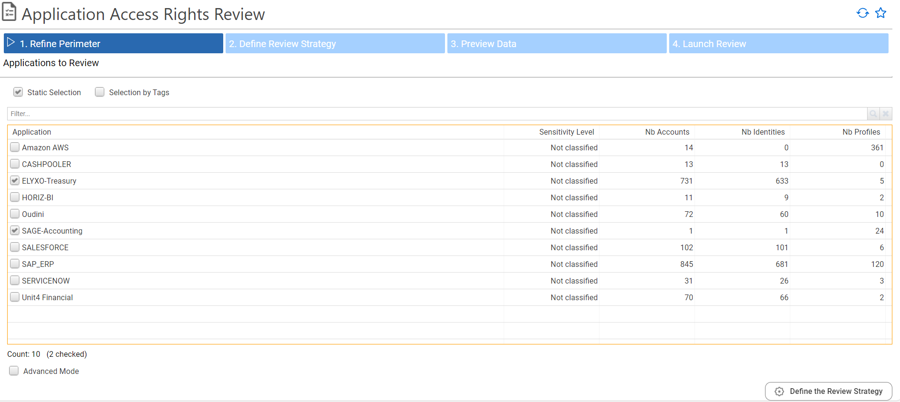

Or you can do it by using tags:

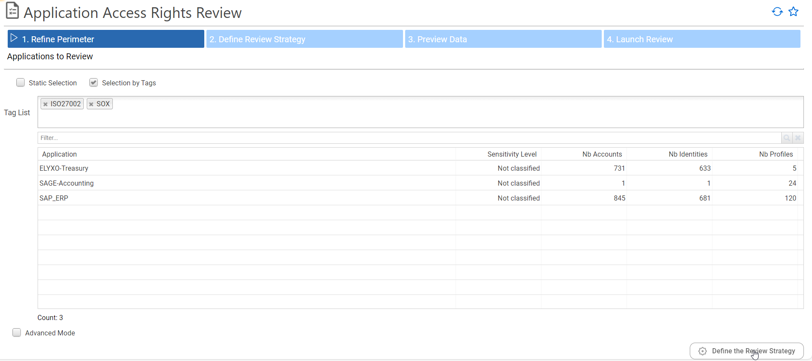

Note that when using tags, filtering the table by column has no effect on the perimeter. Only the filter to the right of "Selection by Tag" does.

The default configuration will review **all** active accounts direct access rights (limited to permission type 'Role')

The reviewer is either a **direct line manager** or an **application owner**.  
Each "user account" will be reviewed by the account owner direct line manager.  
All the other accounts (technical accounts, orphan accounts, ...) will be reviewed by the application owner.

## Review all user accounts access rights per line manager

You can restrict your access review to user accounts only if you want to focus on _business line managers_ as reviewers.  
In order to do so you just have to select _user accounts_ in the _Advanced Mode_ section of the configuration page:

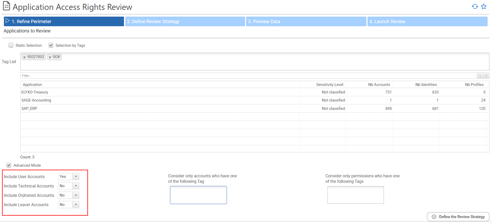

## Review Finance department access rights per line manager

It can be useful to restrict your access review to a given organisation, especially in large organisation.  
Let's say for instance that you want to review SOX applications access rights in the _Finance Department_.

In order to do so, you will have first to tag all accounts belonging to people working for the _finance departement_.

> You can do it by performing an account search followed by a bulk tagging operation.

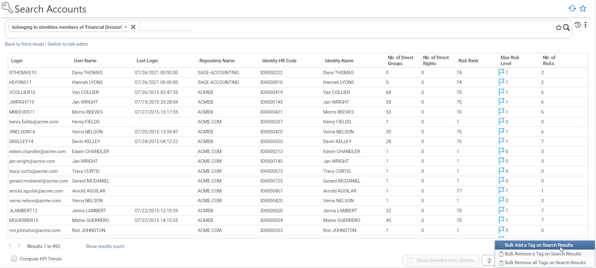

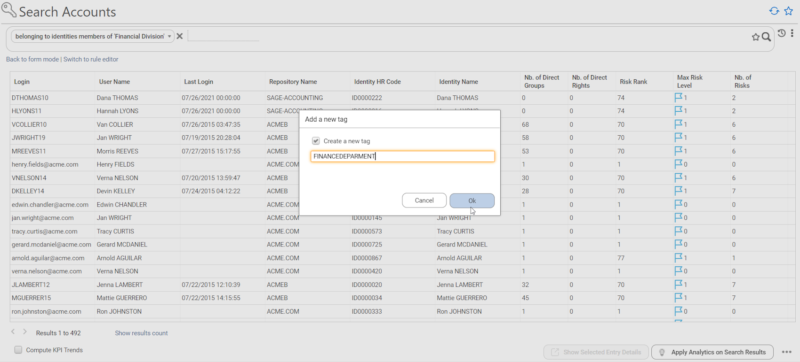

Once done, you will have to select the account tag in the campaign configuration page.

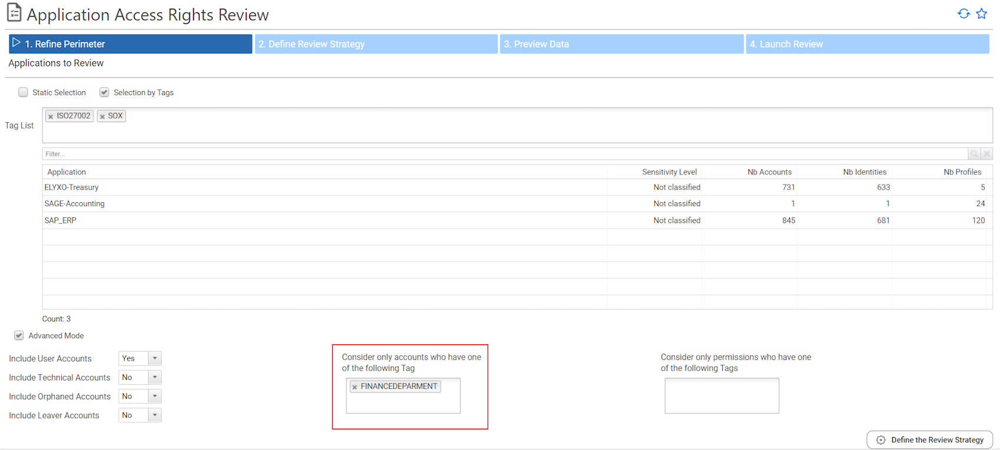

## Review access rights of people who moved from one organisation to another

This use case is very similar to the previous one, you first have to tag the accounts you want to review with a search:


Once done, you will have to select the account tag in the campaign configuration page.

## Review technical accounts access rights per application owner

In order to review technical accounts only, you just have to uncheck _Include User Accounts_ in campaign configuration in the _Advanced Mode_ section:

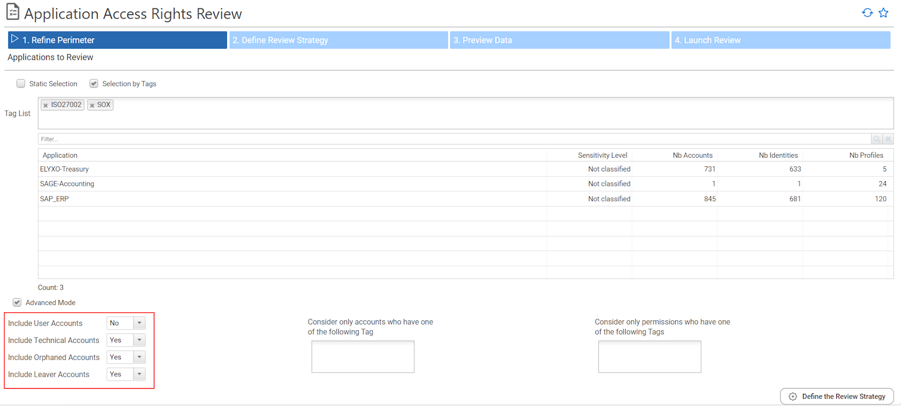

> _Leavers_ account correspond to active accounts belonging to people who are no longer part of the company.

## Review sensitive access rights per application owner

In order to review sensitive access rights you first have to tag your sensitive permissions

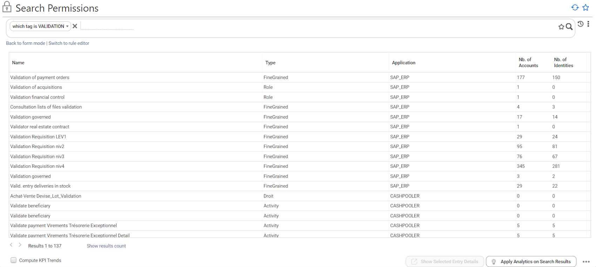

Once this is done, you configure your access right campaign by

- Selecting the tag in the _Permissions Review Perimeter_

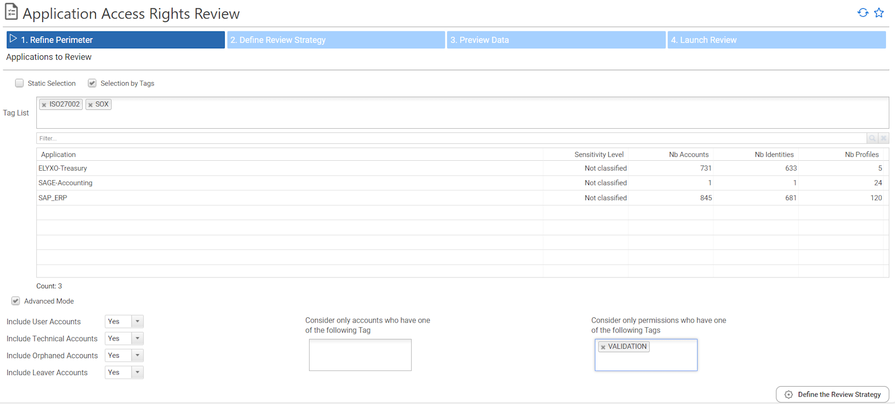

- Force the application owner to review everything in the next step _Review Strategy_:

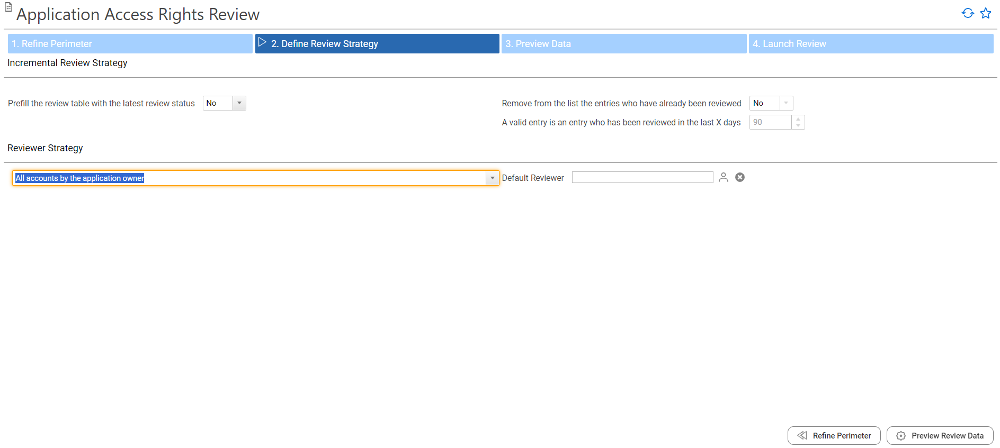

## Self review of all dormant (unused) user accounts by the users themselves

In the next step _Review Strategy_, you can pick _User Accounts by Account Owner_ if you want the user reviewing themselves. This is very useful to review at-risk users or control defects such as outliers and unused access.

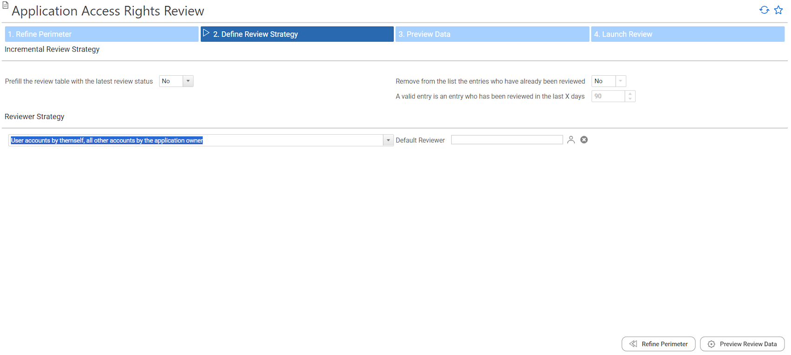

## Review Only the changes since the last review

In order to review only the changes that occurred since the last review, you have to configure your _Incremental Review Strategy_ in the step _Review Strategy_ in the AI Options section:

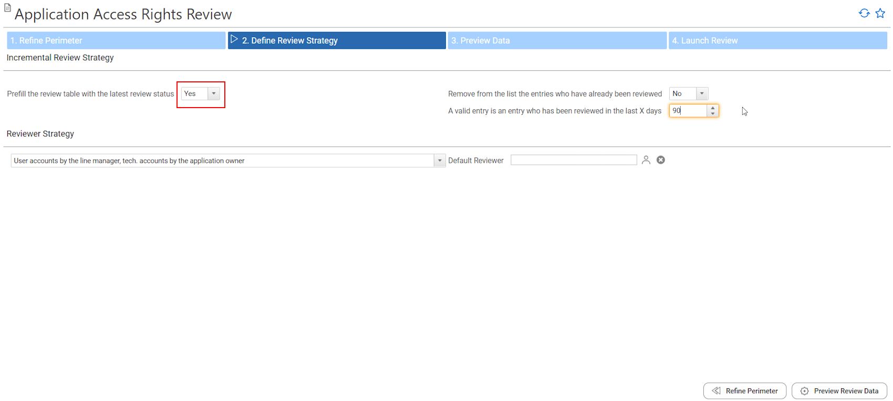

Keep in mind that an entry will be considered as already been reviewed only if all those conditions are met:

- The entry has been reviewed in the configured time frame (X days)
- For a user account, account owner characteristics have not changed (organisation, job title, internal status)

This will fulfill both the status and the comment columns in your review table. You can also simply remove those entries from the review perimeter by checking "Hide Already Removed Entries" (if for instance you only want to review changes that occurred since the last review date, without displaying valid entries).


## Review unused accounts access rights

In order to review unused accounts, you will have first to tag them through an account search leveraging a control result


Once this is done, you configure your access review and select the corresponding tag in _Accounts Review Perimeter_

## Repository accounts review

To launch a repository accounts review, click on "+ Create" button and select "Account Repository Review" in the Access Review Management section. You have to select the repository that you want to include in your accounts review campaign.

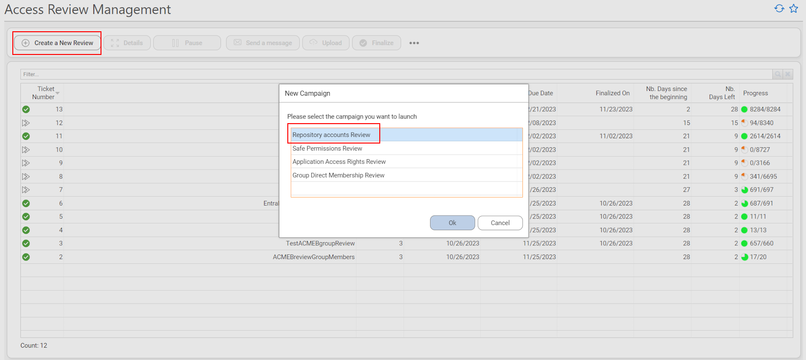  
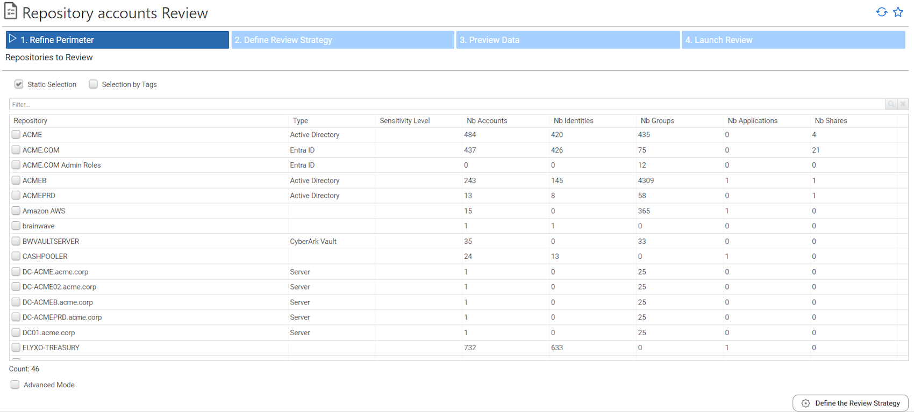

The next steps are the same as application access rights review. Decision history (Incremental review) strategy and reviewers strategy must be defined:

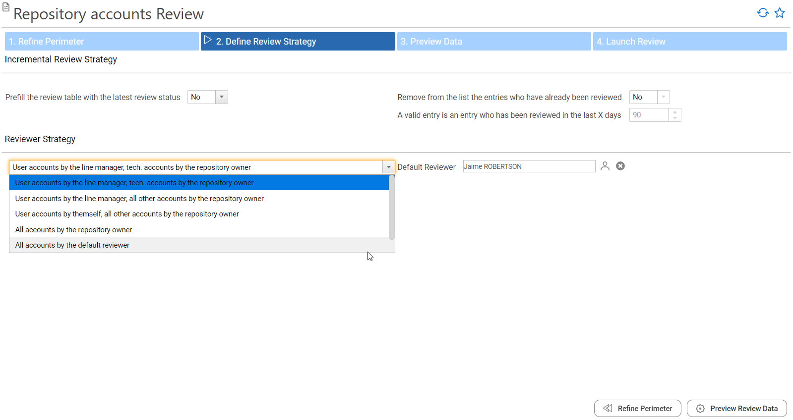

The available _reviewer strategies_ are:

- User accounts by line manager, technical accounts by the repository owner
- User accounts by line manager, all other accounts by the repository owner
- User accounts by themselves, all other accounts by the repository owner
- All accounts by the repository owner
- All accounts by the default reviewer

When the accounts review is launched, review is available on "Access 360" section:

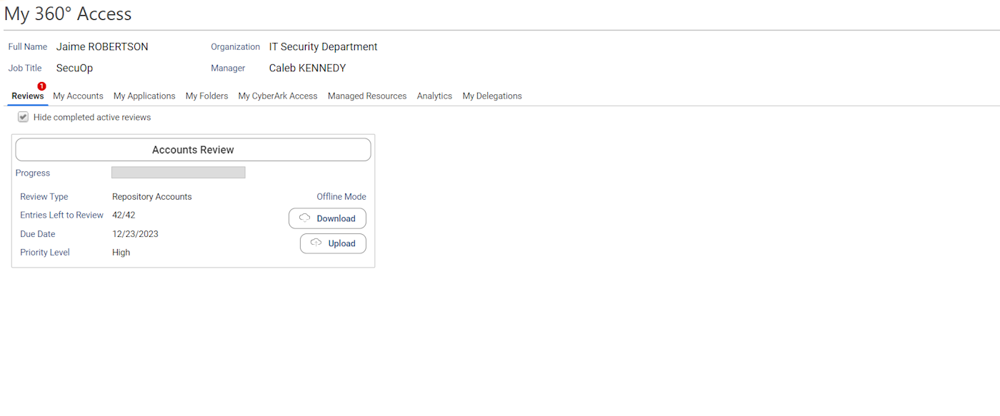

Reviewers can start the accounts review. They can approve, revoke or comment one by one, they can also perform bulk operations by selecting several entries at once.


## Server access rights review

To launch a server access rights review, click on the "+ Create" button and select "Server Review" in the Review Campaign Management section.


You will then need to select the servers that you want to include in your review campaign.


The next steps are the same as application access rights review. **Decision history (Incremental review) strategy** and **reviewers’ strategy** must be defined:


**The available reviewer strategies are:**

- User accounts by line manager, technical accounts by server owner
- User accounts by line manager, all other accounts by server owner
- User accounts by account owner, all other accounts by server owner
- All accounts by server owner
- All accounts by default reviewer

When the server review is launched, the review is available in the **"Access 360"** section:


Reviewers can begin the account review process by approving, revoking, or commenting on individual entries. They also have the option to perform bulk actions by selecting multiple entries at once, or use the cross table to make decisions per cluster.


## Repository group membership review

To launch a direct group membership review, select "Group Membership Review" in the Access Review Management section. You have to select the repository that you want to include in your group review campaign. Note that only direct group members are considered, meaning that an entry to review is composed of the group, its related repository and the direct account member of the related group.

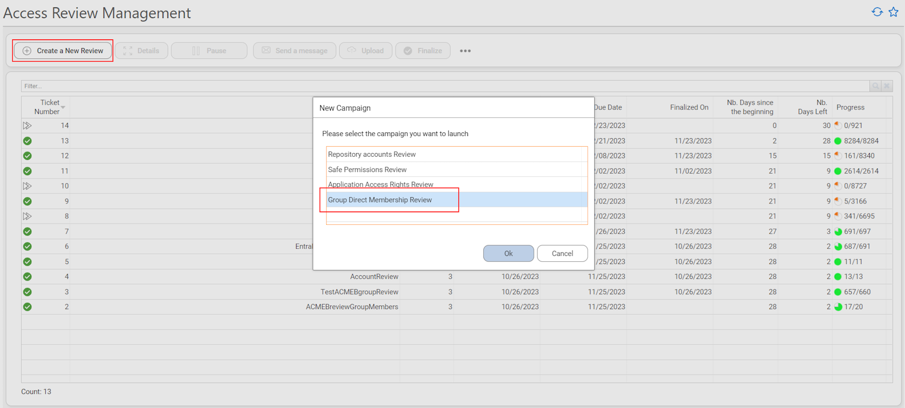  
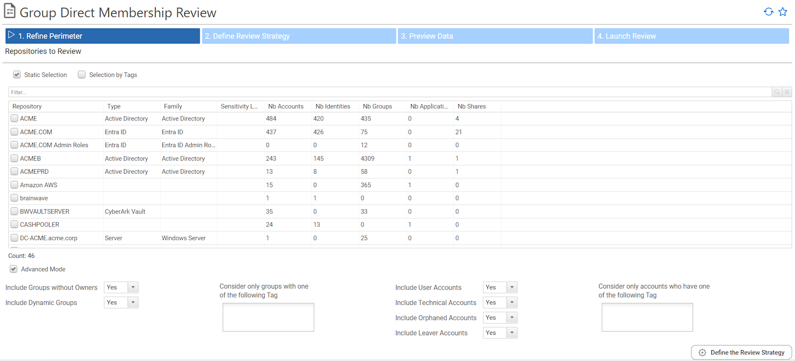

The next steps are the same that application access rights review. Incremental review strategy and reviewers strategy must be defined:

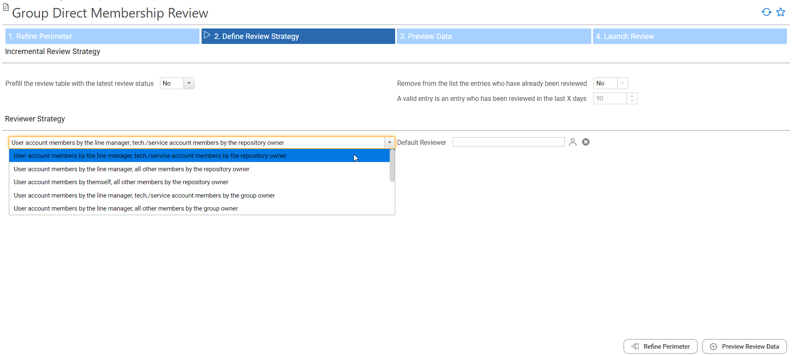

The available _reviewer strategies_ are:

- User account members by line manager, technical/service account members by repository owner
- User account members by line manager, all other members by repository owner
- User account members by themselves, all other members by the repository owner
- User account members by line manager, technical/service account members by group owner
- User account members by line manager, all other members by group owner
- User account members by themselves, all other members by group owner
- All members by group owner
- All members by repository owner
- All members by default reviewer

When the group membership review is launch, review is available on "Access 360" section:

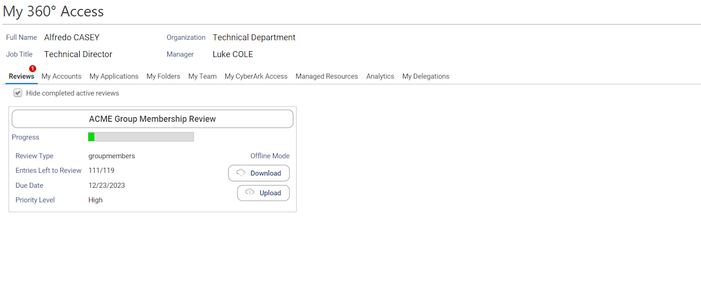

Reviewers can start the group membership review. They can approve, revoke or comment one by one, they can also perform bulk operations by selecting several entries at once.

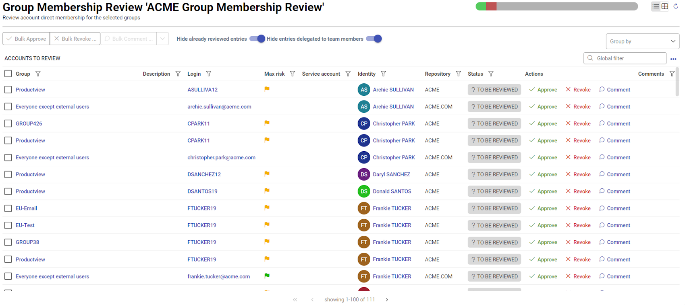

## Server access rights review

To launch a server access rights review, click on "+ Create" button and select "Server Review" in the Review Campaign Management section. You have then to select the servers that you want to include in your review campaign.

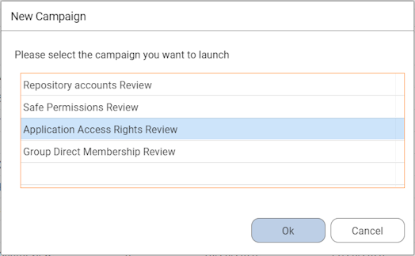


The next steps are the same as application access rights review. Decision history (Incremental review) strategy and reviewers� strategy must be defined:


The available `reviewer strategies` are:

- User accounts by line manager, technical accounts by server owner
- User accounts by line manager, all other accounts by server owner
- User accounts by account owner, all other accounts by server owner
- All accounts by server owner
- All accounts by default reviewer

When the server review is launched, review is available in "Access 360" section:


Reviewers can start the accounts review. They can approve, revoke or comment one by one, they can also perform bulk operations by selecting several entries at once, or use the cross table to take decisions per cluster.


## Sensitive service accounts by account owners, all other accounts by line manager or repository owner

For campaigns such as "Account Repository Review" you can configure more advanced scenarios where you can select who will have to do the review depending on some factors such as risk level, account sensitivity level, last login date, ...
In order to do this you have to enable the `Advanced` mode in the Review Strategy step of the configuration wizard, and click on "Edit Reviewer Script":

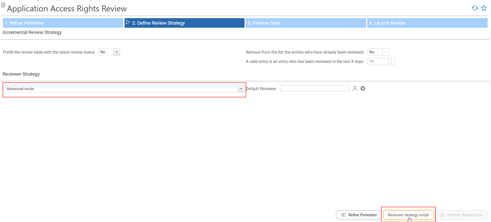

Once done, you can define your strategy through a server side javascript.  
This script will be executed for each individual line to review in order to find a valid reviewer. Here is an example.


When you click OK, a check is performed to identify any errors in the script, and the errors are then highlighted.

```javascript
// This script identifies the reviewer for each individual review line.

// You have to send back a value amongst the following:
// - linemanager
// - repositoryowner
// - accountowner
// - default
// - myself
// - HRCODE value
// You can also send back a list of values such as linemanager,accountowner,repositoryowner,default
// In this case, the first valid reviewer will be taken (valid = reviewer found + reviewer having an email)
//
//
// The following variables are fulfilled for your convenience:
// accountowneruid
// accountownerhrcode
// accountownerfullname
// accountownermail
// linemanageruid
// linemanagerhrcode
// linemanagerfullname
// linemanagermail
// identityuid
// identityhrcode
// identityfullname
// identitymail
// defaultrevieweruid
// defaultreviewerhrcode
// defaultreviewerfullname
// defaultreviewermail
// accountuid
// accountlogin
// repositoryname
// repositoryowneruid
// repositoryownerhrcode
// repositoryownerfullname
// repositoryownermail
// accountmaxrisklevel
// accountsensitivitylevel
// accountnoownercode
// accounttype (user,leave,technical,orphan)
// lastloginindays

if (accounttype.equals("user")) {
  ("linemanager,repositoryowner,default");
} else {
  if (accountsensitivitylevel > 2) "accountowner,repositoryowner,default";
  else "repositoryowner,default";
}
```

> This mode is enabled by default for the functional and technical administration role (`iasreview_funcadmin` and `iasreview_techadmin`). The related feature have to be disabled in your project if you don't want campaign owners to use advanced review strategies. To do so, you have to edit the following feature file: `\webportal\features\bw_iasreview\iasreview.features`. The feature `iasr_accountreviewadvancedreviewermode` for repository accounts reviews has to be associated to the relevant feature sets. Please contact your Identity Analytics project owner to configure this.

## Sensitive permissions by permission owners, all other permissions by line manager or application owner

For campaigns such as "Application Access Rights Review", you can also configure more advanced scenarios where you can select who will have to do the review depending on some factors such as risk level, account sensitivity level, last login date, ...
In order to do this you have to enable the `advanced reviewer selection` mode

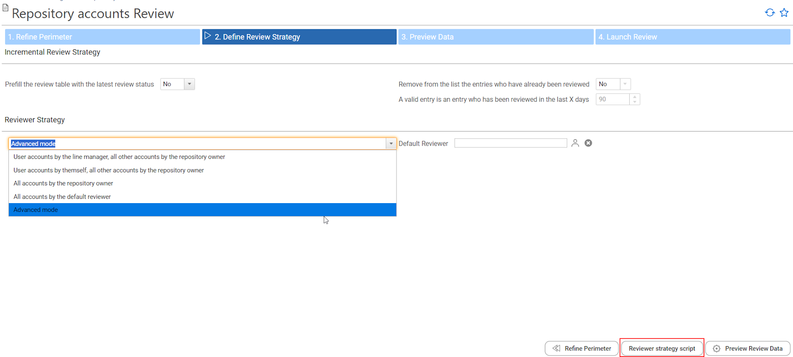

Once done, you can define your strategy through a server side javascript.
This script will be executed for each individual line to review in order to find a valid reviewer. Here is an example.


When you click OK, a check is performed to identify any errors in the script, and the errors are then highlighted.

```javascript
// This script identifies the reviewer for each individual review line.

// You have to send back a value amongst the following:
// - linemanager
// - applicationowner
// - accountowner
// - permissionowner
// - default
// - myself
// - HRCODE value
// You can also send back a list of values such as linemanager,permissionowner,applicationowner,default
// In this case, the first valid reviewer will be taken (valid = reviewer found + reviewer having an email)
//
//
// The following variables are fulfilled for your convenience:
// applicationowneruid
// applicationownerhrcode
// applicationownerfullname
// applicationownermail
// permissionowneruid
// permissionownerhrcode
// permissionownerfullname
// permissionownermail
// accountowneruid
// accountownerhrcode
// accountownerfullname
// accountownermail
// linemanageruid
// linemanagerhrcode
// linemanagerfullname
// linemanagermail
// identityuid
// identityhrcode
// identityfullname
// identitymail
// defaultrevieweruid
// defaultreviewerhrcode
// defaultreviewerfullname
// defaultreviewermail
// accountuid
// accountlogin
// repositoryname
// accountmaxrisklevel
// accountsensitivitylevel
// accountnoownercode
// permissionuid
// permissioncode
// permissionsensitivitylevel
// applicationuid
// applicationcode
// accounttype (user,leave,technical,orphan)
// lastloginindays

if (accounttype.equals("user")) {
  ("linemanager,applicationowner,default");
} else {
  if (permissionsensitivitylevel > 2)
    "permissionowner,applicationowner,default";
  else "applicationowner,default";
}
```

> This mode is enabled by default for the functional and technical administration role (`iasreview_funcadmin` and `iasreview_techadmin`). The related feature have to be disabled in your project if you don't want campaign owners to use advanced review strategies. To do so, you have to edit the following feature file: `\webportal\features\bw_iasreview\iasreview.features`. The feature `iasr_rightreviewadvandedreviewermode` for application rights reviews has to be associated to the relevant feature sets. Please contact your Identity Analytics project owner to configure this.

## Role Permissions Review

A Role Permissions review in IDA requires that all necessary objects and their links be ingested before the review can take place:

- Business Applications and their associated Permissions
- IAM systems and Business Roles
- Links between Business Roles and Application Permissions

The objects reviewed during a Role Permissions review are **IAM Roles / Application Permissions** pairs. Functionally, the goal is to review the content of IAM Roles — that is, every effective permission granted by an IAM role.


To launch a Role Permissions review, select **Role Permissions Review** from the **Review Campaign Management** section.


### Review Perimeter

From the **Review Perimeter** menu, select the IAM Applications and/or Roles to include in your review.

You can also optionally filter the review scope by:

- Permission tag
- Permission sensitivity
- A custom rule on Permission


### Review Strategy

The **Review Strategy** step defines the incremental review and reviewer strategies.

The available reviewer strategies are:

- Role manager if any; default reviewer otherwise
- Role manager if any; if none, application manager; default reviewer otherwise
- Application manager if any; default reviewer otherwise
- Default reviewer

If necessary, an advanced reviewer strategy can be selected (it must be created beforehand in the **Reviewer Policies** section).

> **Note:** **Application** refers to the Business Application, not the IAM system. **Role** refers to the IAM Role.

Incremental review can also be configured here, as with other review types (see [related section](#review-only-the-changes-since-the-last-review)).


### Perimeter Preview

Based on the configuration from the previous steps, the **Perimeter Preview** displays all IAM Roles / Application Permissions pairs to be reviewed, along with their associated reviewers (see [this section](./02-my-first-review.md#step-3---perimeter-preview) for more details).


### Reviewer UI

The **Reviewer UI** step can be configured as with other review types to set up the reviewer user interface, including authorized actions and columns to display (see [this section](./02-my-first-review.md#step-4---reviewer-ui) for more details).


### Campaign Schedule

The **Campaign Schedule** step can be configured as with other review types to set up campaign scheduling (see [this section](./02-my-first-review.md#step-5---campaign-schedule) for more details).


### Campaign Information

The **Campaign Information** step can be configured as with other review types to set up general campaign information (see [this section](./02-my-first-review.md#step-6---campaign-information) for more details).


### Conducting the Review

Once the Role Permissions review is launched, it becomes available to assigned reviewers in the **Access 360** section.


Reviewers can approve, revoke, or comment on entries individually, or perform bulk operations by selecting multiple entries at once (see [this section](./02-my-first-review.md#step-8---reviewing-entries) for more details).


## Unstructured data access rights review

_Unstructured data_ is data that does not fit predefined tables or standard formats. In an identity and access management context, it means access to **folders**: file shares, SharePoint sites, OneDrive, Exchange mailboxes and similar repositories. In this review, each entry is a pair made of an **account** and a **folder** (with its share), along with the right the account holds on that folder (Read, Write, Modify, Full Control, and so on).

Use this review to answer, for every shared folder in scope: _who has access, with what right, and is this access still justified?_

### Prerequisites

- The **Identity Analytics Services** add-on in version **3.7** or later, downloadable from the [RadiantOne Marketplace](https://marketplace.radiantlogic.com/package/bw_ias/). Version 3.7 requires Descartes R6 or later.
- The project license must include the `unstructureddata` keyword.
- Unstructured data must be loaded in the ledger with the latest version of the matching facet. Install the facet, configure the collect, and then run an execution plan.

| Source | Facet |
| --- | --- |
| Windows shared folders (NTFS, CIFS) | Included in [Identity Analytics Services](https://marketplace.radiantlogic.com/package/bw_ias/); the ACL extraction script comes with the `bw_win_sharedfolders` facet |
| Microsoft SharePoint (on premises) | [Microsoft SharePoint – data extraction and collect](https://marketplace.radiantlogic.com/package/bw_sharepoint/) |
| Microsoft 365: SharePoint Online, OneDrive, Exchange Online | [Office 365 – data extraction and collect](https://marketplace.radiantlogic.com/package/bw_office_365/) |
| NFSv4 | [Unix NFSv4 accounts and access rights](https://marketplace.radiantlogic.com/package/bw_nfs4_sharedfolder/) |
| Google Drive | [Google Drive – data extraction and collect](https://marketplace.radiantlogic.com/package/bw_extractorgoogledrive/) |
| Documentum | [Documentum – data collect](https://marketplace.radiantlogic.com/package/bw_documentum/) |

Each facet ships its own PDF documentation in the project's `library/contribs/` folder.

> **Note** Only shares whose application type is `Filesystem` or `Sharepoint` are offered in the review perimeter. This is set by the rule `bwiasr2ud_applications` (`rules/bw_iasreview2/unstructuredData/applications.rule`). If your collect loads shares with another application type, such as `OneDrive`, either load them with one of these types or add the type to the rule.

> **Note** Each share is loaded as an application. Its `applicationfamily` attribute (for example `SharedFolders`, `OneDrive`, `SharePointOnline` or `ExchangeOnline`) is what classifies the share type. It is shown in the **Family** column of the review perimeter and is available to the folder right mapping script. Make sure your collect populates it.

### Creating the campaign

Open **Review** > **Review Campaign Management**, click **+ Create** and select **Unstructured Data Review**:

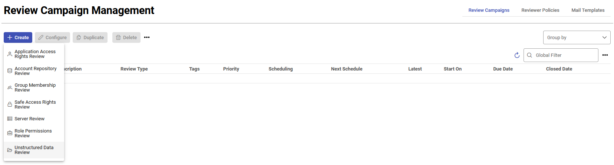

The wizard has the same six steps as the other reviews. Only the steps that differ are described below.

#### Review Perimeter

Select the **resources** (shares or file systems) to review, one by one or with **Selection by Tag**. Selecting a resource includes all of its folders in the review.

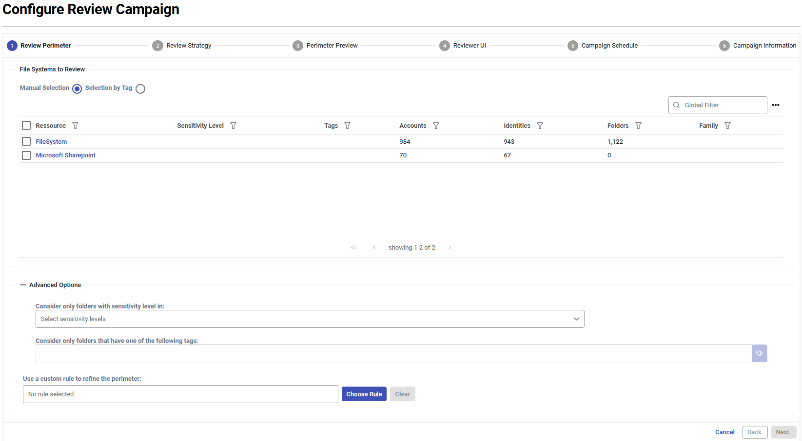

For each resource, the table shows its **Sensitivity Level**, **Tags**, **Family**, and the number of **Accounts**, **Identities** and **Folders** concerned. The `...` menu can also show the **Code**, **Sensitivity reason**, **Description** and file system type columns.

Only direct rights are reviewed. Rights a folder inherits from a parent folder are not part of the perimeter.

Expand **Advanced Options** to narrow the perimeter:

- **Consider only folders with sensitivity level in**: keep only folders with the selected sensitivity levels:

  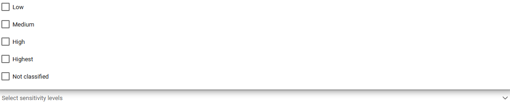

- **Consider only folders that have one of the following tags**: keep only tagged folders.
- **Use a custom rule to refine the perimeter**: apply a rule built in the Studio. The rule must belong to the `Perimeter` family and be part of the deployed execution plan.

#### Review Strategy

Pick the **Default Reviewer** (the campaign creator by default), then one of the predefined reviewer strategies:

- User Accounts by Line Manager, Technical Accounts by Resource Owner, Other Accounts by Default Reviewer
- User Accounts by Line Manager, Technical Accounts by Technical Account Owner, Other Accounts by Default Reviewer
- User Accounts by Line Manager, All Other Accounts by Resource Owner
- User Accounts by themselves, Other Accounts by Resource Owner
- All Accounts by Resource Owner if any, by Default Reviewer otherwise
- All Accounts by Default Reviewer
- All Accounts by Permission Owner if any, by Default Reviewer otherwise

The **resource owner** is the share owner whose expertise domain is `Reviewer`. If no such owner exists, the share's `Business Owner` is used. The **permission owner** is the owner of the folder. When no valid reviewer is found (no owner, no line manager, or no email address), the entry goes to the default reviewer.

##### Advanced reviewer policy

Select **Advanced** and click **Edit Reviewer Policy** to choose the reviewer with a server-side JavaScript script, as for the [other reviews](#sensitive-permissions-by-permission-owners-all-other-permissions-by-line-manager-or-application-owner). Reviewer policy templates can be saved from the **Reviewer Policies** tab of the Review Campaign Management page.

For this review, the script must return one or more of the following values, separated by commas: `linemanager`, `shareowner`, `accountowner`, `folderowner`, `default`, `myself`, or an HR code. The first valid reviewer is used.

The following variables are available, in addition to the account, identity, line manager and default reviewer variables already listed for the other reviews:

| Object | Variables |
| --- | --- |
| Share | `shareuid`, `sharecode`, `shareowneruid`, `shareownerhrcode`, `shareownerfullname`, `shareownermail`, `sharecustom1` to `sharecustom3` |
| Folder | `folderuid`, `foldercode`, `foldersensitivitylevel`, `folderowneruid`, `folderownerhrcode`, `folderownerfullname`, `folderownermail`, `foldercustom1` to `foldercustom3` |
| Account, repository, identity | `accountcustom1` to `accountcustom3`, `repositorycustom1` to `repositorycustom3`, `identitycustom1` to `identitycustom3` |

For example, to have sensitive folders reviewed by their owner and everything else by the line manager:

```javascript
if (typeof foldersensitivitylevel != "undefined" && foldersensitivitylevel > 2) "folderowner,shareowner,default";
else "linemanager,shareowner,default";
```

> **Note** When you click **OK**, the script is checked, and that check reports the share and folder variables (for example `foldersensitivitylevel` or `shareowneruid`) as not defined, even though they are set when the script runs. Test them with `typeof` first, as in the example above. A folder without a sensitivity level gives `null`.

##### Custom folder right mapping

Folder rights are collected as technical ACL codes, such as `RGFE` or `RWXGAFEMDL`. The **Custom Folder Right Mapping** script turns each code into a readable label. The raw code is shown in the **Permission Right Action** column, and the label in the **Custom Display Name** column.

The script is a server-side JavaScript expression that returns the label. The ACL code is available in the `folderrightaction` variable.

The default mapping is:

| ACL code | Label |
| --- | --- |
| `RGFE` | Read (Windows) |
| `RXGFE` | Read and Execute/List Folder Content (Windows) |
| `WGAML` | Write (Windows) |
| `RWG` | Read and Write (Windows) |
| `RWXGAFEMDL` | Modify (Windows) |
| `RWXGASPFEMDL` | Full Control (Windows) |
| `R` | Read (Identity Analytics) |
| `WAMLDS` | Update (Identity Analytics) |
| `PO` | Control (Identity Analytics) |
| any other value | Special (Windows) |

To adapt the mapping, click **Edit Mapping**:

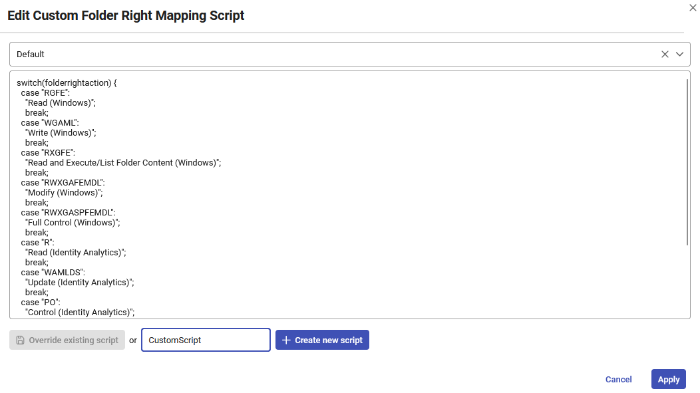

1. Optionally, pick the script to start from in the drop-down list at the top: **Default**, or one of the custom scripts already saved.
2. Edit the script.
3. Type a name next to **Create new script** and click it, or click **Override existing script** to update the custom script you selected. The **Default** script cannot be overwritten, so keep a copy of your custom scripts under version control.
4. Click **Apply**.

The script runs when the campaign starts. Its labels are shown in the Perimeter Preview, in the **Permission Right Action** column of the reviewer page and in the **Right (Custom)** column of the campaign's **Entries to review** tab.

#### Perimeter Preview

The preview lists one line per account and folder, with the reviewer, the account and identity details, the **Permission** (folder), its **Owner Code**, the raw **Permission Right Action**, the mapped **Custom Display Name**, the **Resource** (share) and the **Last Review Status**.

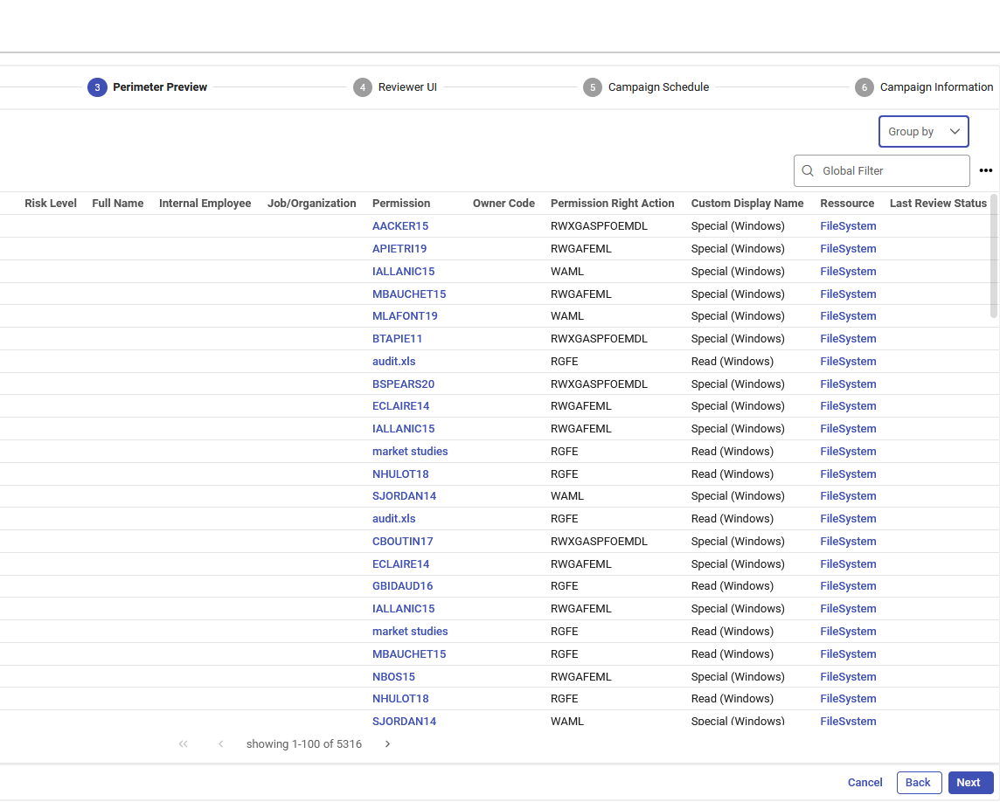

Use **Group by** to group the lines by **Account**, **Identity**, **Permission**, **Resource**, **Reviewer** or **Reviewer Type**:

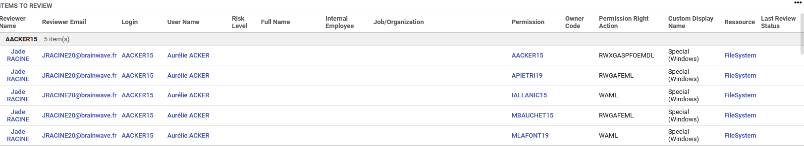

The **Reviewer UI**, **Campaign Schedule** and **Campaign Information** steps work as described in [My first review](./02-my-first-review.md#step-4---reviewer-ui).

### Reviewing folder rights

Reviewers find the campaign in **My 360° Access** > **Reviews**. Each line is one account with its right on one folder. The **Permission Right Action** column shows the label produced by the folder right mapping script, but its column filter lists the raw ACL codes:

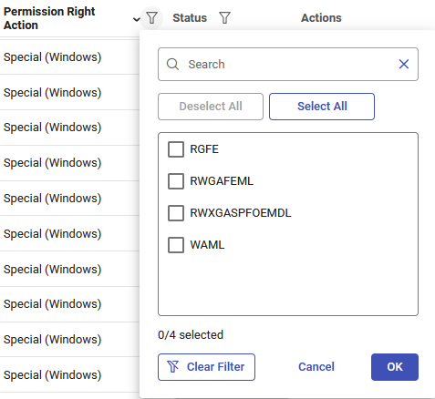

Besides **Approve**, **Revoke** and **Comment**, the `...` menu next to the actions offers **Update**, **I am not the reviewer**, **Ask team for help** and **Reset**, depending on the options set in the Reviewer UI step:

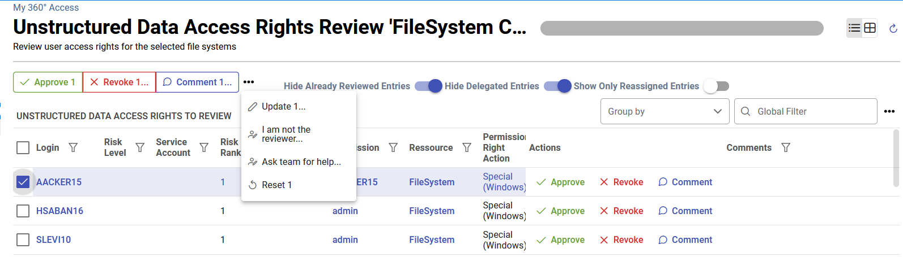

The `...` menu at the top right of the table exports the entries to CSV or XLSX, opens advanced filtering, and lets the reviewer choose the displayed columns:

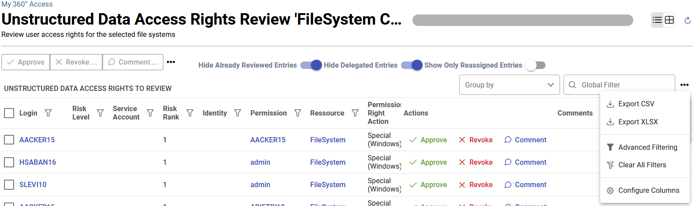

The campaign owner follows the campaign from **Review** > **Review Campaign Management**: select the campaign and click **Details** in the **Latest Review** panel. The **Entries to review** tab lists each entry with its reviewer, account, identity, folder path, mapped right (**Right (Custom)**), share and review status, and supports the force bulk actions (approval, revocation, update, reset, sign-off and comment) on behalf of the reviewers:

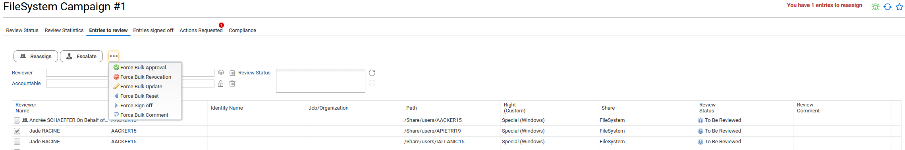

### Remediating revoked folder rights

Revoked folder rights are remediated like application rights. See [Step 10 - Finalizing the review campaign](./02-my-first-review.md#step-10---finalizing-the-review-campaign) and [Step 11 - Following up the remediation](./02-my-first-review.md#step-11---following-up-the-remediation). The following points are specific to unstructured data:

- The remediation strategy is attached to each share, in **Remediation** > **Remediation Strategy Management**, **Unstructured Data** tab. See [Configuring the remediation strategy](./03-key-concepts.md#configuring-the-remediation-strategy). If no strategy is attached to a share, the embedded strategy is used.

  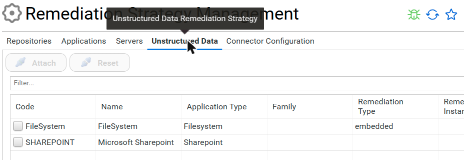

  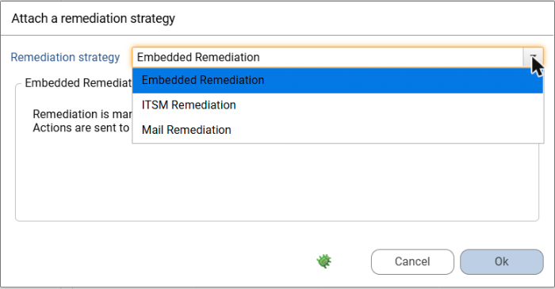

- With the embedded strategy, the remediation actions are sent to the technical owners of the share, so make sure each share has one.
- In **Remediation Management**, these remediations have the **Unstructured Data** target, and their **Resource** reads `<account> on <share> (<folder> [<ACL code>])`. It shows the raw ACL code, not the label produced by the folder right mapping script.