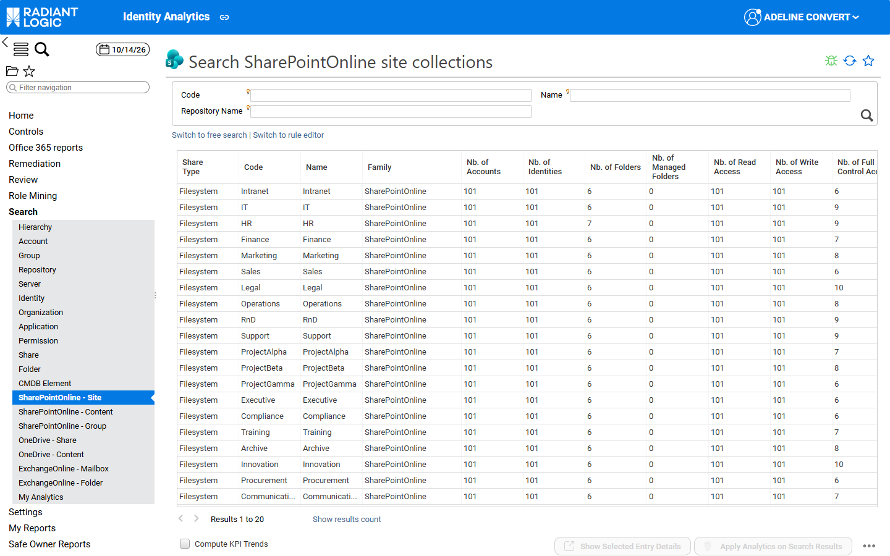
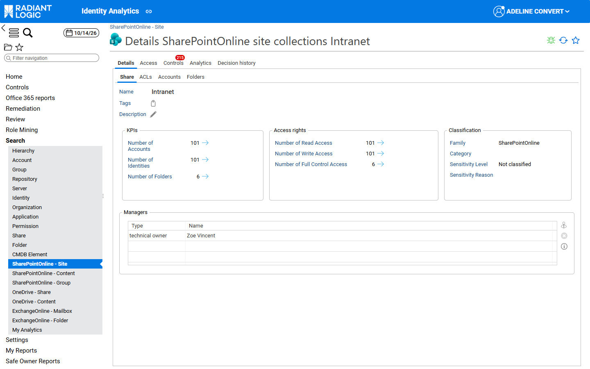
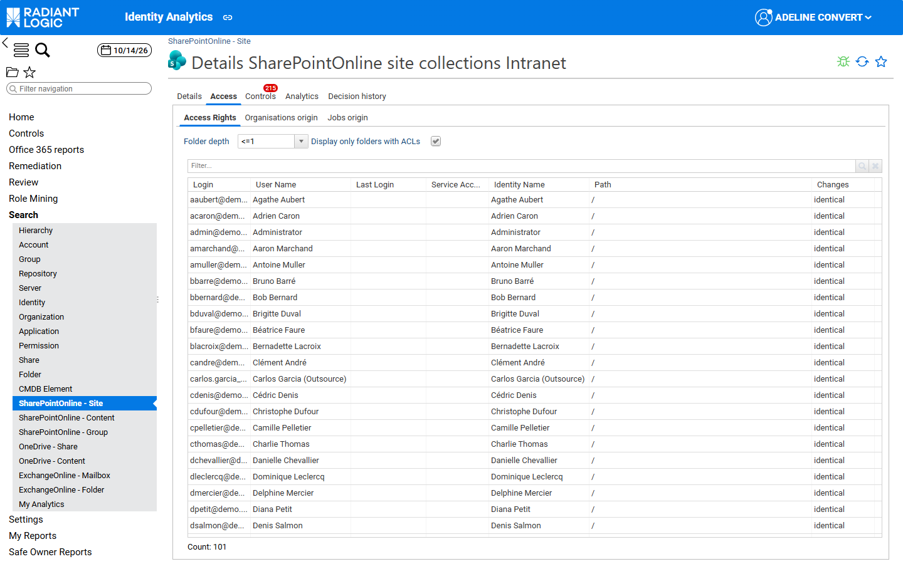
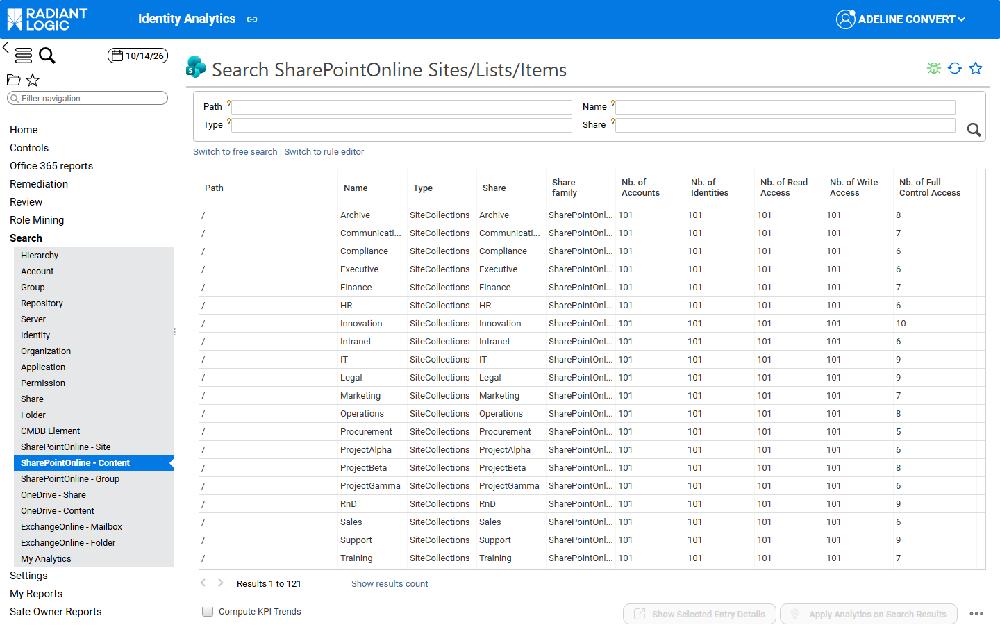
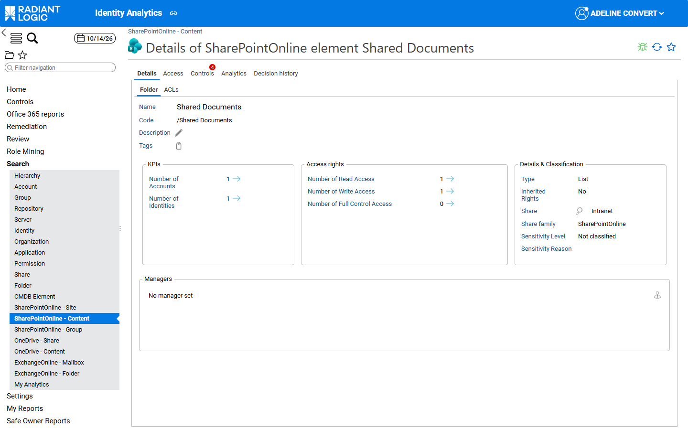
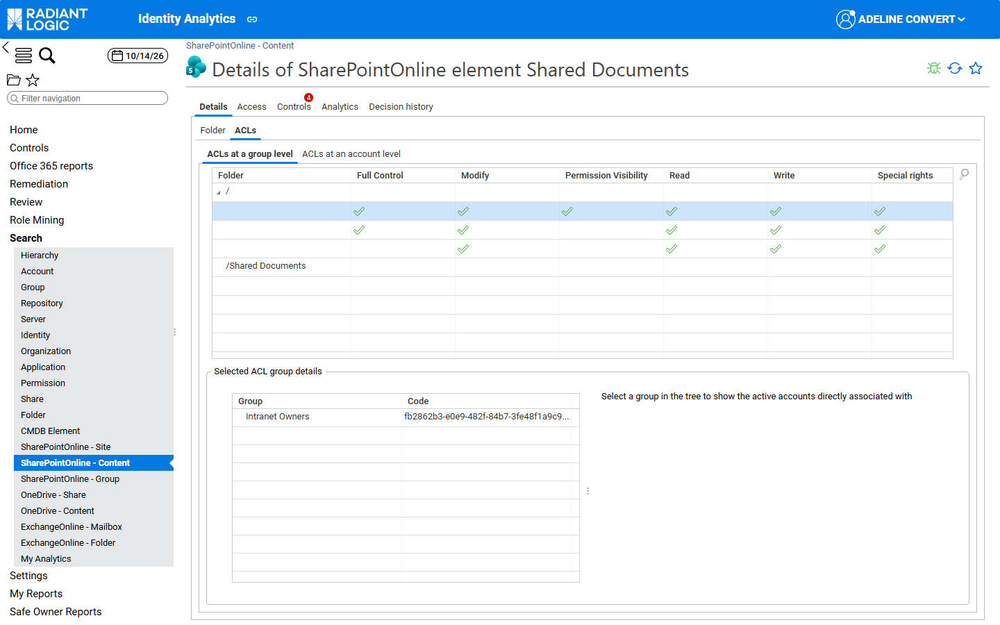
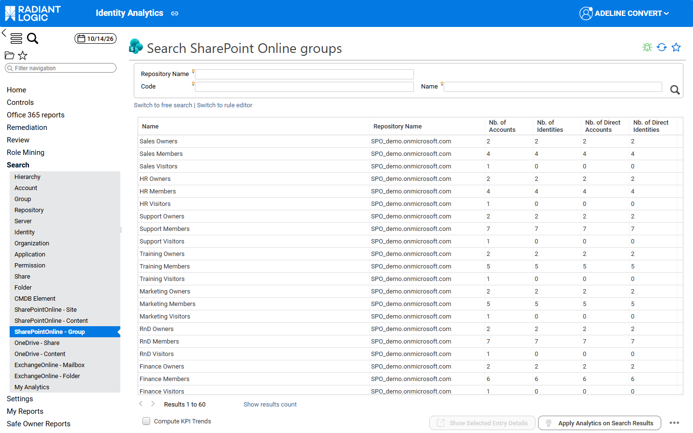
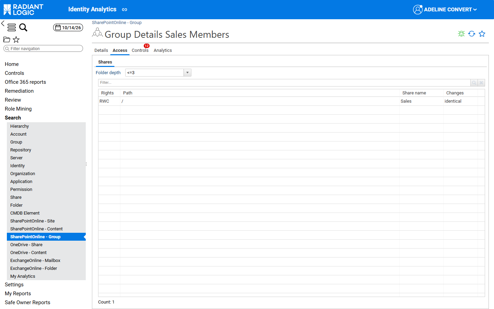

# SharePoint Online pages

This page describes the search pages and the detail pages of SharePoint Online site collections, content and groups. They work like the other Office 365 search pages, as described in [Search and detail pages](/office-365/03-search-and-detail-pages/). The other families are [OneDrive pages](./02-onedrive) and [Exchange Online pages](./03-exchange-online).

## Overview

The following search pages belong to this family:

| **Menu entry**             | **Page title**                              | **Lists**                                                         |
| :------------------------- | :------------------------------------------ | :---------------------------------------------------------------- |
| SharePointOnline - Site    | Search SharePointOnline site collections    | SharePoint Online site collections                                |
| SharePointOnline - Content | Search SharePointOnline Sites/Lists/Items   | Site roots, lists and folders of SharePoint Online sites          |
| SharePointOnline - Group   | Search SharePoint Online groups             | SharePoint Online groups                                          |

## SharePoint Online site collections

### Site collections search page

The **SharePointOnline - Site** search page lets you list, filter, and build queries on SharePoint Online site collections loaded in Identity Analytics. Use it, for example, to find the sites with an unusual number of accounts having full control, or to compare the number of accounts that can read and write on each site.

The form filters on **Code**, **Name** and **Repository Name**.

The following computed KPIs are available by default:

| **attribute name**  | **description**                                                          |
| :------------------ | :----------------------------------------------------------------------- |
| nbaccount           | Number of active accounts                                                |
| nbidentity          | Number of identities with active accounts                                |
| nbfolder            | Number of folders                                                        |
| nbreadaccess        | Number of accounts with read access, based on SharePoint Online rights   |
| nbwriteaccess       | Number of accounts with write access, based on SharePoint Online rights  |
| nbfullcontrolaccess | Number of accounts with full control, based on SharePoint Online rights  |

The **Nb. of Managed Folders** and usage KPIs can be added with **Configure**.

### Site collection details page

The site collection details page helps end users understand who can access a SharePoint Online site and how. Its tabs are the same as for a share. For more details, see [Share](../../identity-analytics/enduser-guide/03-detail-pages#share).

- The **Details** tab contains the **Share**, **ACLs**, **Accounts** and **Folders** sub‑tabs.  
  In the **Share** sub‑tab, the **Access rights** section shows the **Number of Read Access**, **Number of Write Access** and **Number of Full Control Access** of the site, computed from the SharePoint Online rights. The **Managers** section shows the owner of the site.  

- In the **ACLs** sub‑tab, the ACLs set on the site and its content are displayed with the SharePoint Online columns (**Full Control**, **Modify**, **Permission Visibility**, **Read**, **Write** and **Special rights**). For more details, see [SharePoint Online ACLs](../05-acl-and-rights/01-sharepoint-online#sharepoint-online-acls).  
- The **Access** tab contains the **Access Rights**, **Organisations origin** and **Jobs origin** sub‑tabs, and a **Usages** sub‑tab when usages have been loaded.  
  In the **Access Rights** sub‑tab, the **Folder depth** combobox and the **Display only folders with ACLs** checkbox work as on the share details page. The table lists each account with the path on which it has access.  

- The **Controls** tab lists the control discrepancies detected on the site and its content, for example **SPO - Public Group Access on Site**. For the list of Office 365 controls, see [Office 365 controls](../06-controls#control-reference).  
- The **Analytics** and **Decision history** tabs work as for a share.

## SharePoint Online content

### Content search page

The **SharePointOnline - Content** search page lets you list, filter, and build queries on the content of SharePoint Online sites: site roots, lists and folders. Use it, for example, to find the lists or folders that grant access to more accounts than the site itself.

The form filters on **Path**, **Name**, **Type** and **Share** (the site collection). The **Type** column shows the kind of element: `SiteCollections` for the root of a site (path `/`), `List` or `Folder`.

The following computed KPIs are available by default:

| **attribute name**  | **description**                                                            |
| :------------------ | :------------------------------------------------------------------------- |
| nbaccount           | Number of active accounts                                                  |
| nbidentity          | Number of identities with active accounts                                  |
| nbreadaccess        | Number of accounts with read access, based on SharePoint Online rights     |
| nbwriteaccess       | Number of accounts with write access, based on SharePoint Online rights    |
| nbfullcontrolaccess | Number of accounts with full control, based on SharePoint Online rights    |

### Content details page

The content details page presents a site root, list or folder of a SharePoint Online site. Its tabs are the same as for a folder. For more details, see [Folder](../../identity-analytics/enduser-guide/03-detail-pages#folder).

- In the **Folder** sub‑tab of the **Details** tab, key KPIs and management information are displayed. The **Access rights** section shows the read, write and full control counts of the element. The **Details & Classification** section shows the element **Type**, whether its rights are inherited from its parent (**Inherited Rights**), and the site it belongs to (**Share**). Clicking the magnifier icon next to the site name opens the site detail window.  

- In the **ACLs** sub‑tab, the **ACLs at a group level** and **ACLs at an account level** sections use the SharePoint Online columns. Selecting a group ACL displays the group hierarchy in the **Selected ACL group details** section. Selecting an ACL and clicking the magnifier icon on the right side of the table opens the **SharePoint Online ACL details** window, which lists each SharePoint permission granted by the ACL. For more details, see [SharePoint Online ACLs](../05-acl-and-rights/01-sharepoint-online#sharepoint-online-acls).  

- The **Access** tab contains the **Accounts**, **Organisations origin** and **Jobs origin** sub‑tabs, and a **Usages** sub‑tab when usages have been loaded.  
- The **Controls** tab lists the control discrepancies detected on the element, for example **SPO - Broken Inheritance - Depth 2-3** or **SPO - Permission Granted Directly to User**.

## SharePoint Online groups

The **SharePointOnline - Group** search page lets you list, filter, and build queries on SharePoint Online groups only (for example the *Owners*, *Members* and *Visitors* groups of each site). Use it to check how many accounts and identities each site group contains, directly or through nested groups.

The form filters on **Repository Name**, **Code** and **Name**. By default the table shows the **Nb. of Accounts**, **Nb. of Identities**, **Nb. of Direct Accounts** and **Nb. of Direct Identities** KPIs. The number of applications and shares of each group can be added with **Configure**. For the list of group KPIs, see [Group search page](../../identity-analytics/enduser-guide/04-search-pages#group-search-page).

Clicking a group opens the standard group details page. For more details, see [Groups](../../identity-analytics/enduser-guide/03-detail-pages#groups). In the **Shares** sub‑tab of the **Access** tab, the SharePoint Online sites on which the group has rights are listed, with the simplified ACL in the **Rights** column.

