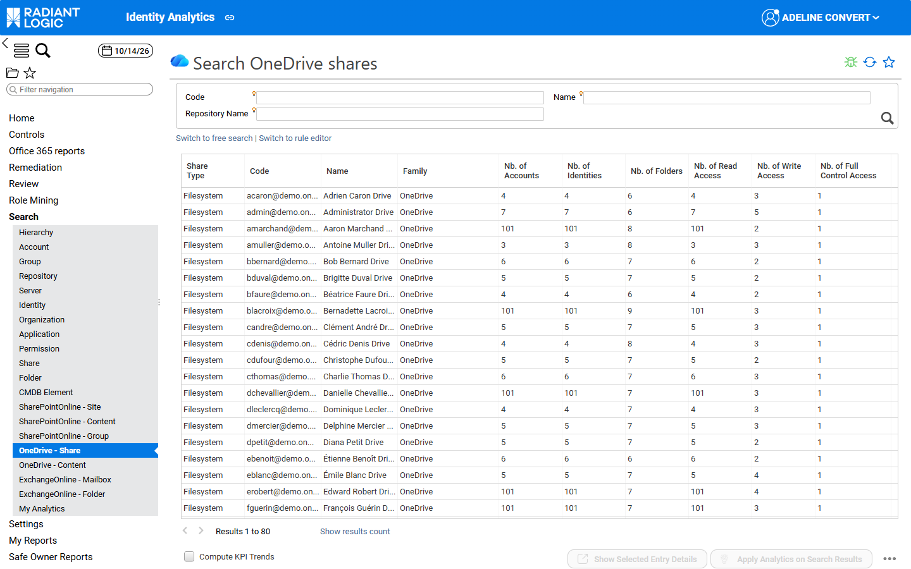
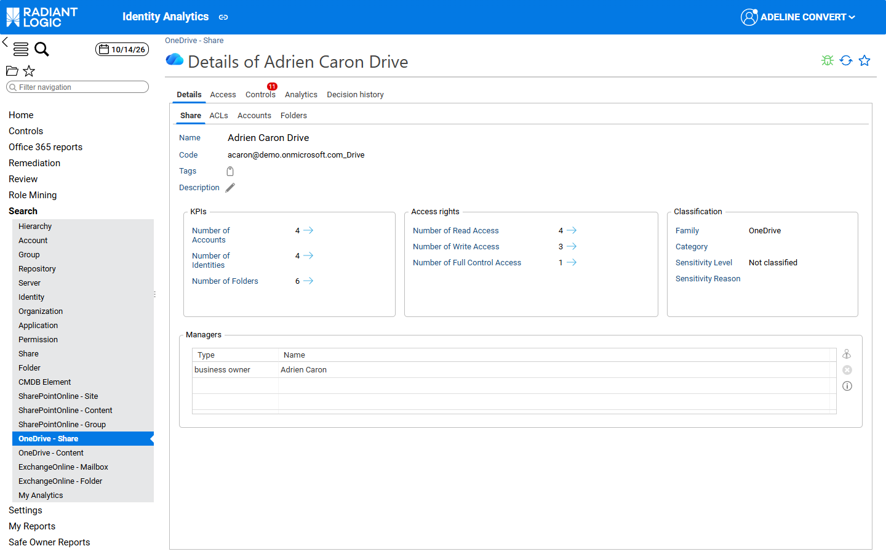
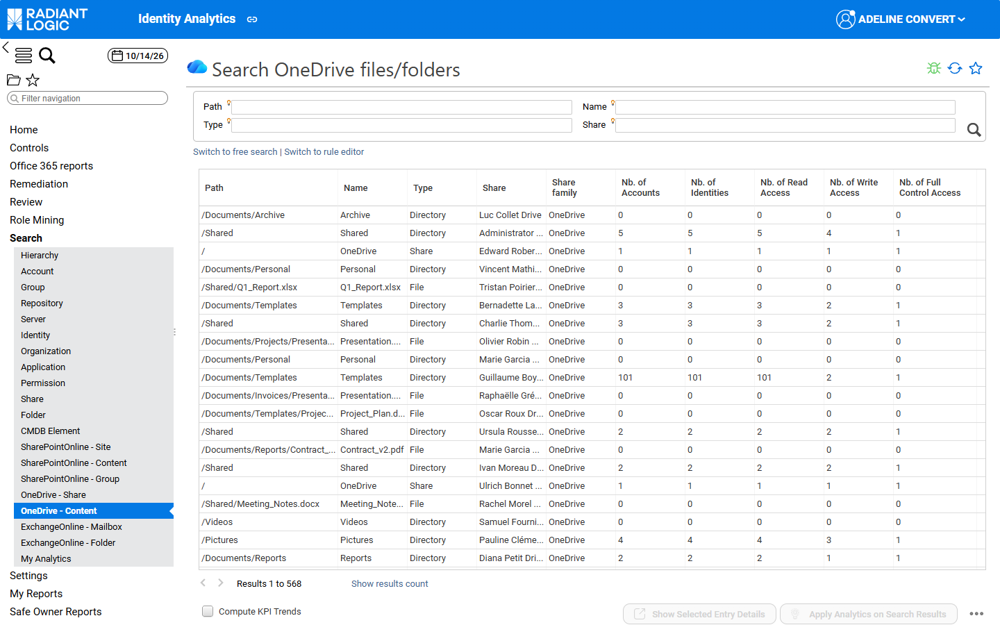
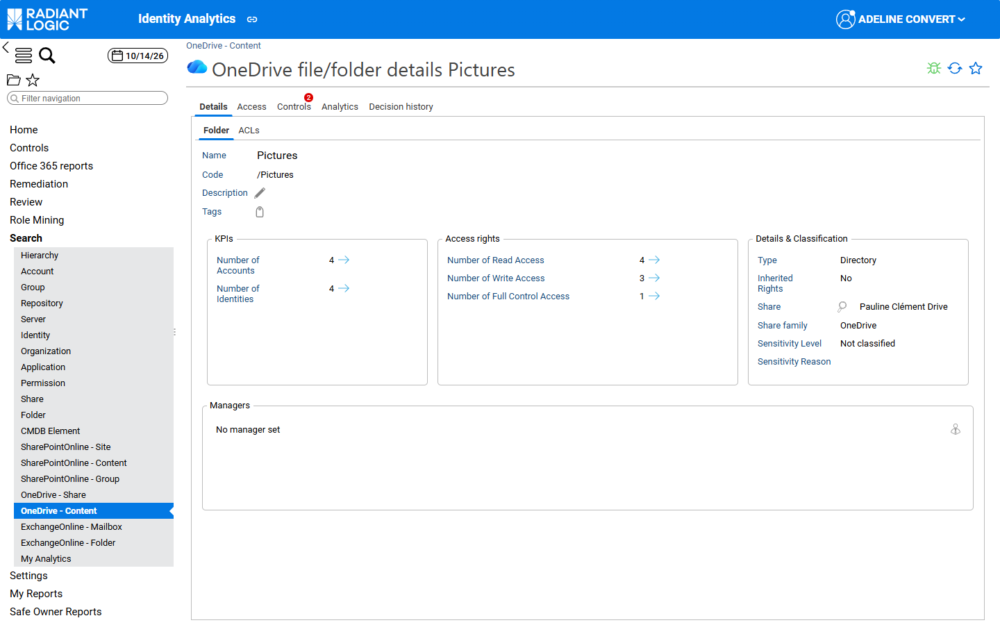

# OneDrive pages

This page describes the search pages and the detail pages of OneDrive drives, files and folders. They work like the other Office 365 search pages, as described in [Search and detail pages](/office-365/03-search-and-detail-pages/). The other families are [SharePoint Online pages](./01-sharepoint-online) and [Exchange Online pages](./03-exchange-online).

## Overview

The following search pages belong to this family:

| **Menu entry**             | **Page title**                              | **Lists**                                                         |
| :------------------------- | :------------------------------------------ | :---------------------------------------------------------------- |
| OneDrive - Share           | Search OneDrive shares                      | OneDrive drives                                                   |
| OneDrive - Content         | Search OneDrive files/folders               | Files and folders stored in OneDrive drives                       |

## OneDrive drives

### Drives search page

The **OneDrive - Share** search page lets you list, filter, and build queries on OneDrive drives. Use it, for example, to find the drives that are accessible by many accounts besides their owner.

The form filters on **Code**, **Name** and **Repository Name**. The default KPIs are the same as on the [Share search page](../../identity-analytics/enduser-guide/04-search-pages#share-search-page): number of accounts, identities and folders, and number of read, write and full control accesses. For OneDrive, these KPIs are computed as for Windows shares.

### Drive details page

The drive details page has the same tabs and sub‑tabs as a SharePoint Online site collection (see [Site collection details page](./01-sharepoint-online#site-collection-details-page)). The **Managers** section of the **Share** sub‑tab shows the owner of the drive.

OneDrive rights are displayed with the standard Windows columns (**Full Control**, **Modify**, **Read & Execute**, **Read**, **Write**, **Special rights**), and the **Show Advanced Permissions** checkbox is available. For more details, see [OneDrive ACLs](../05-acl-and-rights/03-onedrive#onedrive-acls).

In the **Access Rights** sub‑tab of the **Access** tab, the **Access type** column shows the simplified ACL of each account (for example `RWC`).

## OneDrive files and folders

### Files and folders search page

The **OneDrive - Content** search page lets you list, filter, and build queries on the files and folders stored in OneDrive drives. Use it, for example, to find the folders of a drive that are shared with other accounts.

The form filters on **Path**, **Name**, **Type** and **Share** (the drive). The **Type** column shows `Share` for the root of a drive, `Directory` for a folder and `File` for a file. The default KPIs are the same as on the [Content search page](./01-sharepoint-online#content-search-page), computed as for Windows folders.

### File or folder details page

The file or folder details page has the same tabs and sub‑tabs as a SharePoint Online content element (see [Content details page](./01-sharepoint-online#content-details-page)). Clicking the magnifier icon next to the drive name in the **Details & Classification** section opens the drive detail window. The **ACLs** sub‑tab uses the standard Windows columns.

