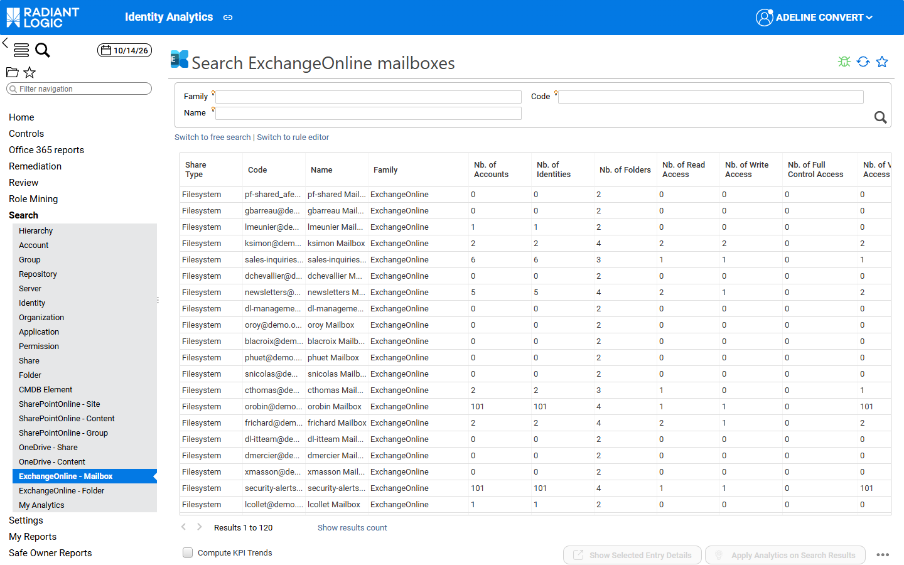
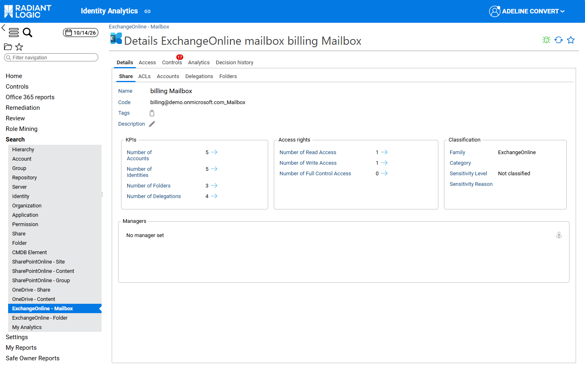
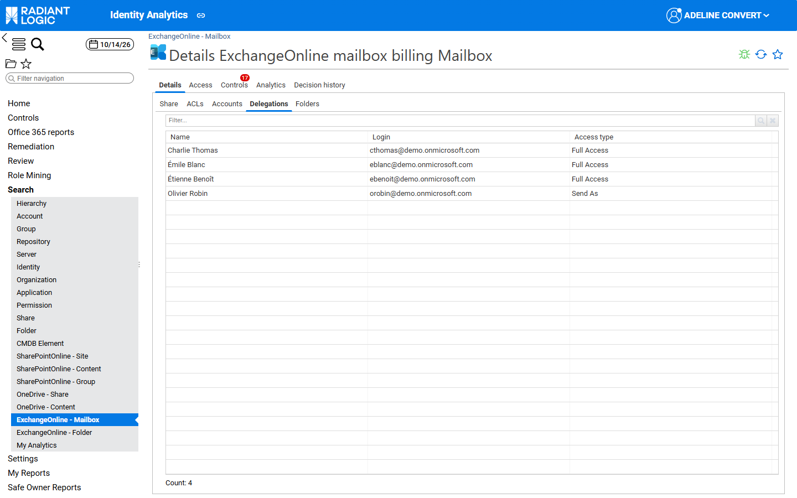
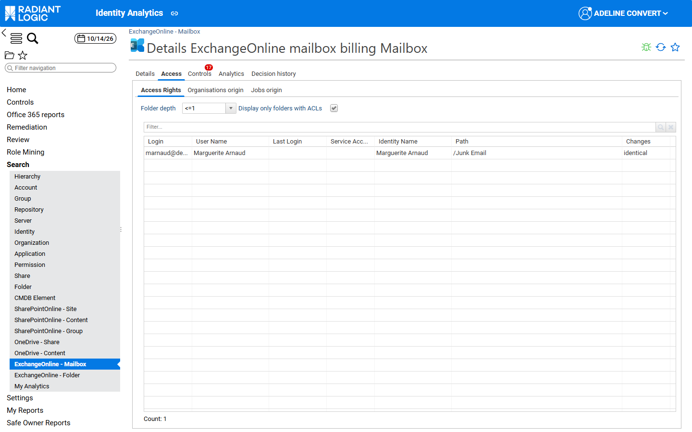
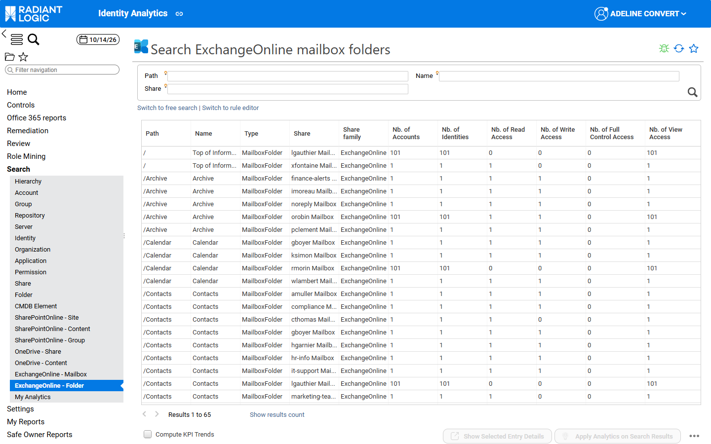
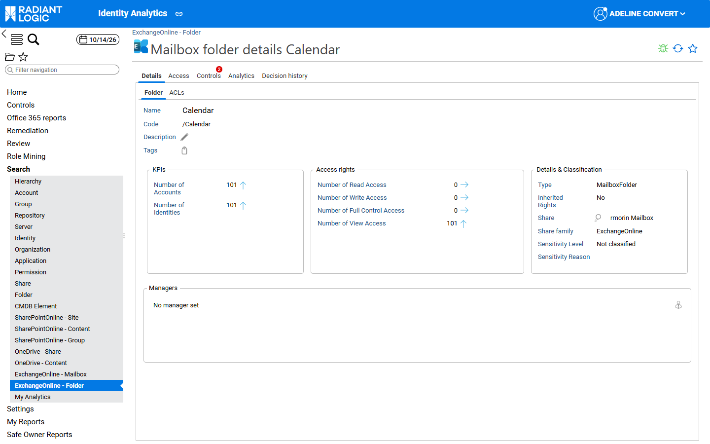

# Exchange Online pages

This page describes the search pages and the detail pages of Exchange Online mailboxes and mailbox folders. They work like the other Office 365 search pages, as described in [Search and detail pages](/office-365/03-search-and-detail-pages/). The other families are [SharePoint Online pages](./01-sharepoint-online) and [OneDrive pages](./02-onedrive).

## Overview

The following search pages belong to this family:

| **Menu entry**             | **Page title**                              | **Lists**                                                         |
| :------------------------- | :------------------------------------------ | :---------------------------------------------------------------- |
| ExchangeOnline - Mailbox   | Search ExchangeOnline mailboxes             | Exchange Online mailboxes (user and shared mailboxes)             |
| ExchangeOnline - Folder    | Search ExchangeOnline mailbox folders       | Folders of Exchange Online mailboxes                              |

## Exchange Online mailboxes

### Mailboxes search page

The **ExchangeOnline - Mailbox** search page lets you list, filter, and build queries on Exchange Online mailboxes. Use it, for example, to find the mailboxes with the most delegations, or the mailboxes whose folders are visible to many accounts.

The form filters on **Family**, **Code** and **Name**.

The following computed KPIs are available by default:

| **attribute name**  | **description**                                                                       |
| :------------------ | :------------------------------------------------------------------------------------ |
| nbaccount           | Number of active accounts                                                             |
| nbidentity          | Number of identities with active accounts                                             |
| nbfolder            | Number of folders                                                                     |
| nbreadaccess        | Number of accounts with read access to a folder of the mailbox                        |
| nbwriteaccess       | Number of accounts with write access to a folder of the mailbox                       |
| nbfullcontrolaccess | Number of accounts that own a folder of the mailbox                                   |
| nbviewaccess        | Number of accounts that can view a folder of the mailbox (**Nb. of View Access**)     |
| nbdelegation        | Number of accounts with a delegation on the mailbox (**Nb. of Delegations**)          |

### Mailbox details page

The mailbox details page helps end users understand who can open, read or send emails from a mailbox. Its tabs are the same as for a share (see [Share](../../identity-analytics/enduser-guide/03-detail-pages#share)), with the following additions:

- In the **Share** sub‑tab of the **Details** tab, the **KPIs** section also shows the **Number of Delegations**. The **Number of Folders** doesn’t count the root of the mailbox (*Top of Information Store*) and the technical entry that holds the mailbox delegations.  

- In the **ACLs** sub‑tab, the rights on the mailbox folders are displayed with the Exchange Online columns. For more details, see [Exchange Online ACLs](../05-acl-and-rights/02-exchange-online#exchange-online-acls).  
- In the **Delegations** sub‑tab, a table lists the accounts that hold a delegation on the mailbox, such as **Send As** or **Full Access**. This sub‑tab is displayed only when the mailbox has at least one delegation.  
  Clicking a name in the **Name** column opens the identity detail window. Clicking a login in the **Login** column opens the account detail window.  
  The **Access type** column shows the delegation. The email and HR code of the identity can be added with **Configure**.  

- In the **Access Rights** sub‑tab of the **Access** tab, the table lists each account with the mailbox folder on which it has access.  

The **Access type** column of the **Delegations** sub‑tab can show the following delegations:

| **Access type**   | **Meaning**                                                                                                         |
| :---------------- | :------------------------------------------------------------------------------------------------------------------ |
| Send As           | The delegate can send messages as if they came directly from the mailbox. Recipients can’t see the delegate.        |
| Send on Behalf    | The delegate can send messages from the mailbox; recipients see that the delegate sent them on behalf of the mailbox. |
| Full Access       | The delegate can open the mailbox and view, add and remove its content, but can’t send messages from it.            |
| Change Owner      | The delegate can change the owner of the mailbox.                                                                   |
| Change Permission | The delegate can change the permissions of the mailbox.                                                             |
| Delete Item       | The delegate can delete items of the mailbox.                                                                       |
| Read Permission   | The delegate can read the permissions of the mailbox.                                                               |
| External Account  | The delegate account isn’t part of the same domain.                                                                 |

## Exchange Online mailbox folders

### Mailbox folders search page

The **ExchangeOnline - Folder** search page lets you list, filter, and build queries on the folders of Exchange Online mailboxes (for example **/Calendar**, **/Contacts** or **/Archive**). Use it, for example, to find the calendars or folders that are visible to all users.

The form filters on **Path**, **Name** and **Share** (the mailbox). The root of each mailbox is listed with the path `/` (*Top of Information Store*).

The following computed KPIs are available by default:

| **attribute name**  | **description**                                                        |
| :------------------ | :--------------------------------------------------------------------- |
| nbaccount           | Number of active accounts                                              |
| nbidentity          | Number of identities with active accounts                              |
| nbreadaccess        | Number of accounts with read access, based on Exchange Online rights   |
| nbwriteaccess       | Number of accounts with write access, based on Exchange Online rights  |
| nbfullcontrolaccess | Number of accounts that own the folder                                 |
| nbviewaccess        | Number of accounts that can view the folder (**Nb. of View Access**)   |

### Mailbox folder details page

The mailbox folder details page has the same tabs and sub‑tabs as a SharePoint Online content element (see [Content details page](./01-sharepoint-online#content-details-page)). The **Access rights** section also shows the **Number of View Access**.

In the **ACLs** sub‑tab, the rights are displayed with the Exchange Online columns, and the magnifier icon opens the **Exchange Online ACL details** window. For more details, see [Exchange Online ACLs](../05-acl-and-rights/02-exchange-online#exchange-online-acls).
