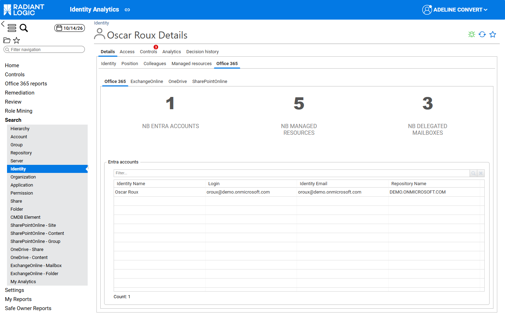
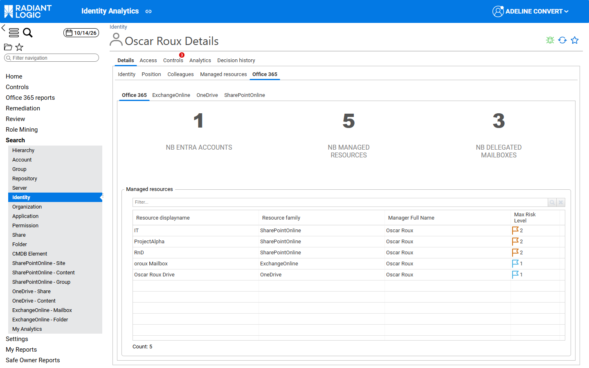
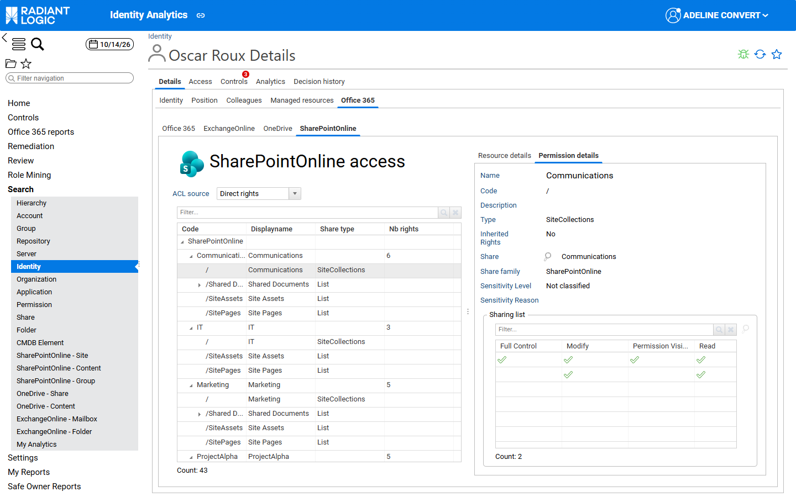
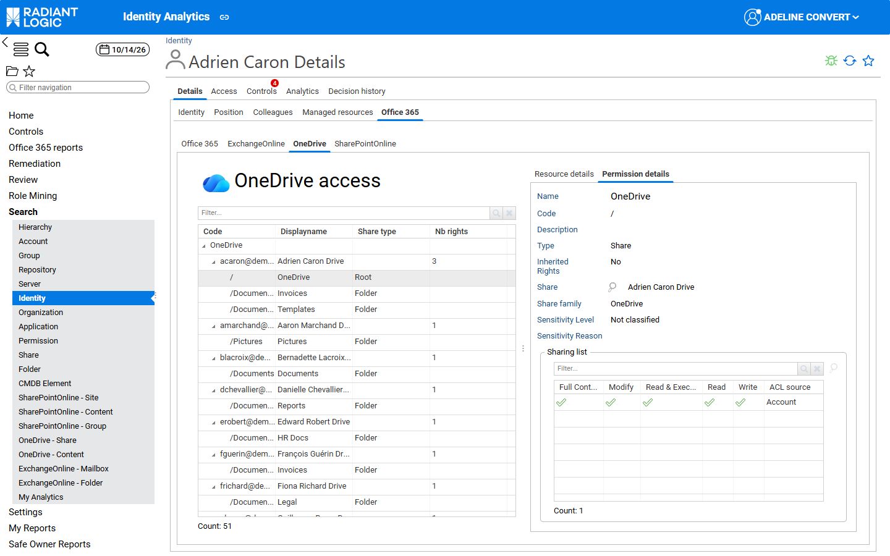
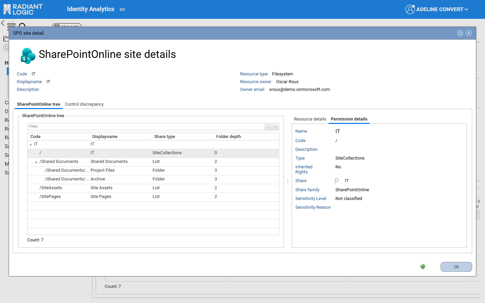
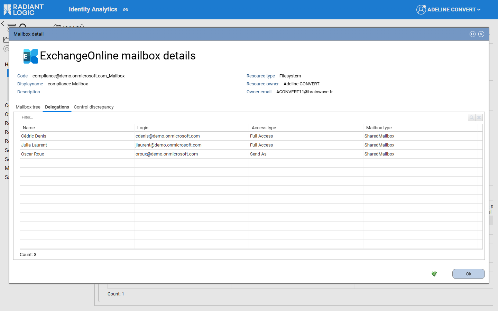
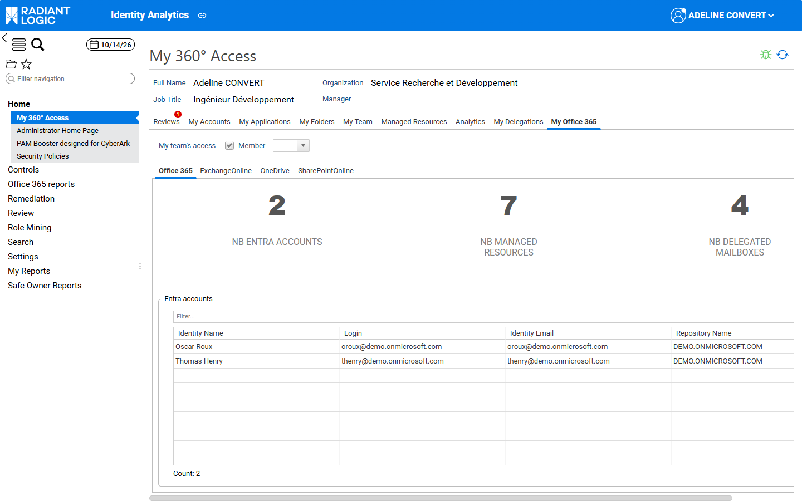

# Office 365 tab and generic pages

This page describes the Office 365 tab of the identity details page and of Access 360, and how the generic pages show Office 365 data.

## Office 365 tab

The **Office 365** tab summarises, for one identity, everything related to Microsoft 365: the Microsoft Entra ID accounts of the identity, the Microsoft 365 resources the identity manages, the mailboxes the identity can access through a delegation, and the identity’s rights in Exchange Online, OneDrive and SharePoint Online. It is displayed in two places:

- On the identity details page, as the **Office 365** sub‑tab of the **Details** tab. For more details, see [Identities details page](../identity-analytics/enduser-guide/03-detail-pages#identities-details-page).
- In Access 360, as the **My Office 365** tab, which shows the same information for the signed‑in user and, for managers, for their team. For more details, see [Access 360](../identity-analytics/enduser-guide/02-access360#for-standard-users).

Both are displayed only if Office 365 has been activated in the project.

### KPIs and tables

The first inner tab, **Office 365**, shows three KPIs: **Nb Entra accounts**, **Nb managed resources** and **Nb delegated mailboxes**. Clicking a KPI displays the corresponding table below it:

- **Nb Entra accounts** displays the **Entra accounts** table, which lists the Microsoft Entra ID accounts reconciled with the identity, with the **Identity Name**, **Login**, **Identity Email** and **Repository Name** columns.  
  Clicking the identity name opens the identity detail window. Clicking the login opens the account detail window.  

- **Nb managed resources** displays the **Managed resources** table, which lists the SharePoint Online sites, Exchange Online mailboxes and OneDrive drives for which the identity is business owner or technical owner, with the **Resource displayname**, **Resource family**, **Manager Full Name** and **Max Risk Level** columns. The resource code and the owner’s email can be added with **Configure**.  
  Clicking a name in the **Manager Full Name** column opens the identity detail window.  
  The **Max Risk Level** column shows the highest risk level of the control discrepancies detected on each resource, so that owners can focus on the riskiest resources first.  
  Clicking a resource opens its detail window (see [Resource detail windows](#resource-detail-windows)).  

- **Nb delegated mailboxes** displays the **Delegated mailbox** table, which lists the user and shared mailboxes on which the identity holds a delegation, with the **Mailbox**, **Mailbox displayname**, **Mailbox owner**, **Name**, **Login**, **Access type** and **Mailbox type** columns. The **Mailbox owner** column is filled only when an owner has been loaded for the mailbox. For the meaning of each access type, see [Mailbox details page](./03-search-and-detail-pages/03-exchange-online#mailbox-details-page).

### Workload tabs

The **ExchangeOnline**, **OneDrive** and **SharePointOnline** inner tabs are displayed only when the identity has at least one right in the corresponding workload. Each of them shows:

- on the left, a tree of the resources the identity can access (mailboxes, drives or sites), then their folders or lists, with the **Code**, **Displayname**, **Share type** and **Nb rights** columns. In the **OneDrive** tab, the **Share type** column shows **Root** for the root of a drive, **Folder** for a folder and **File** for a file;
- on the right, the **Resource details** and **Permission details** tabs, which describe the resource or the element selected in the tree;
- under **Permission details**, the **Sharing list**, which lists all ACLs set on the selected element with the columns of the workload (see [Office 365 ACLs](./05-acl-and-rights/#office-365-acls)). The **ACL source** column indicates whether the right is granted to an **Account**, through a **Group** or through a **Public group**. Selecting an ACL and clicking the magnifier icon opens the ACL details window of the workload.

In the **SharePointOnline** tab, the **ACL source** combobox filters the tree: **Direct rights** (default), **Public group rights** or **All rights**.  

In the **OneDrive** tab, the `/` row of each drive is its root (**Share type** **Root**), followed by its folders (**Folder**).  

### Resource detail windows

Clicking a resource in the **Managed resources** table opens a detail window that depends on the workload: **SPO site detail**, **Mailbox detail** or **OneDrive detail**. The upper part shows the **Code**, **Displayname**, **Description**, **Resource type**, **Resource owner** and **Owner email** of the resource. The window contains the following tabs:

- **SharePointOnline tree**, **Mailbox tree** or **OneDrive tree**: the content of the resource with its **Folder depth**, and on the right the **Resource details** and **Permission details** of the selected element. Unlike the workload tabs, the **Permission details** of these windows don’t include the **Sharing list**.  
- **Delegations** (mailboxes only, when the mailbox has delegations): the accounts that hold a delegation on the mailbox, with their **Access type**.  
- **Control discrepancy**: the control discrepancies detected on the resource.  

> **Note** The **Mailbox type** column of the **Delegations** tab currently shows the raw value (for example `SharedMailbox`). See [Known limitations](./09-known-limitations).  

## Office 365 and the generic pages

When Office 365 is activated in the project, some generic pages of the portal also show Office 365 data. This section lists them. The Office 365 data aren’t documented in the generic guides.

### Access 360

- In the **My Office 365** tab, users see their Microsoft 365 footprint: their Microsoft Entra ID accounts, the SharePoint Online sites, Exchange Online mailboxes and OneDrive drives they manage, the mailboxes they can access through a delegation (for example **Send As** or **Full Access**), and their rights in Exchange Online, OneDrive and SharePoint Online. This tab is only available if Office 365 has been activated in the project.  
  Clicking the **Nb Entra accounts**, **Nb managed resources** or **Nb delegated mailboxes** KPI displays the corresponding table. The **ExchangeOnline**, **OneDrive** and **SharePointOnline** tabs are displayed only when the user has rights in the corresponding workload.  
  Users who manage a team also see the **My team’s access** checkbox and the **Member** combobox at the top of the tab. Selecting **My team’s access** displays the same information for all the members of their team; selecting a member in the **Member** combobox restricts it to that member.  
  For a full description of the content of this tab, see [Office 365 tab](#office-365-tab).

  

### Identity details page

- In the **Office 365** sub‑tab, the end user can view the Microsoft 365 footprint of the selected identity: its Microsoft Entra ID accounts, the SharePoint Online sites, Exchange Online mailboxes and OneDrive drives it manages, the mailboxes it can access through a delegation, and its rights in Exchange Online, OneDrive and SharePoint Online. This sub‑tab is only available if Office 365 has been activated in the project.  
  Clicking the **Nb Entra accounts**, **Nb managed resources** or **Nb delegated mailboxes** KPI displays the corresponding table. The **ExchangeOnline**, **OneDrive** and **SharePointOnline** tabs are displayed only when the identity has rights in the corresponding workload; each of them shows a tree of the resources the identity can access and the ACLs set on the selected element.  
  For more details, see [Office 365 tab](#office-365-tab).  

### Group details page

The **Shares** sub‑tab of the **Access** tab of a group details page also lists the rights set for the group at the root of SharePoint Online sites and on Exchange Online mailbox folders. For more details, see [SharePoint Online groups](./03-search-and-detail-pages/01-sharepoint-online#sharepoint-online-groups).  

### Share details page

- In the **ACLs** sub‑tab, two sections list the ACLs set on the share at group level and at account level, as described for the [Folder](../identity-analytics/enduser-guide/03-detail-pages#folder) details page. The ACL columns depend on the share family: SharePoint Online and Exchange Online use their own columns, without **Show Advanced Permissions**. For more details, see [Office 365 ACLs](./05-acl-and-rights/#office-365-acls).  

- In the **Delegations** sub‑tab, available only for Exchange Online mailboxes that have at least one delegation, a table lists the accounts that hold a delegation on the mailbox (for example **Send As** or **Full Access**). For more details, see [Mailbox details page](./03-search-and-detail-pages/03-exchange-online#mailbox-details-page).  

For Exchange Online mailboxes, the **Share** sub‑tab also shows the **Number of Delegations** KPI. SharePoint Online sites, OneDrive drives and Exchange Online mailboxes also have dedicated search and detail pages. For more details, see [Office 365 pages](./03-search-and-detail-pages/).  

### Folder details page

SharePoint Online and Exchange Online folders have their own ACL columns, without **Show Advanced Permissions**, on their dedicated detail pages and in their detail windows. There, clicking the magnifier icon opens the **SharePoint Online ACL details** or **Exchange Online ACL details** window, which lists every permission granted by the selected ACL. For more details, see [Office 365 ACLs](./05-acl-and-rights/#office-365-acls) and [Office 365 pages](./03-search-and-detail-pages/).  

### Search pages

When Office 365 has been activated in the project, SharePoint Online site collections, Exchange Online mailboxes and OneDrive drives aren’t listed on the **Share** search page: use the **SharePointOnline - Site**, **ExchangeOnline - Mailbox** and **OneDrive - Share** search pages instead. For more details, see [Office 365 pages](./03-search-and-detail-pages/).  

When Office 365 has been activated in the project, SharePoint Online, Exchange Online and OneDrive folders aren’t listed on the **Folder** search page: use the **SharePointOnline - Content**, **ExchangeOnline - Folder** and **OneDrive - Content** search pages instead. For more details, see [Office 365 pages](./03-search-and-detail-pages/).

When Office 365 has been activated in the project, seven additional search pages are available for SharePoint Online site collections, content and groups, OneDrive drives and files, and Exchange Online mailboxes and folders. They list, filter, and build queries on these entities with KPIs adapted to each workload, such as the number of accounts that can view the folders of a mailbox (**Nb. of View Access**) or the number of delegations of a mailbox (**Nb. of Delegations**). For more details, see [Office 365 pages](./03-search-and-detail-pages/).
