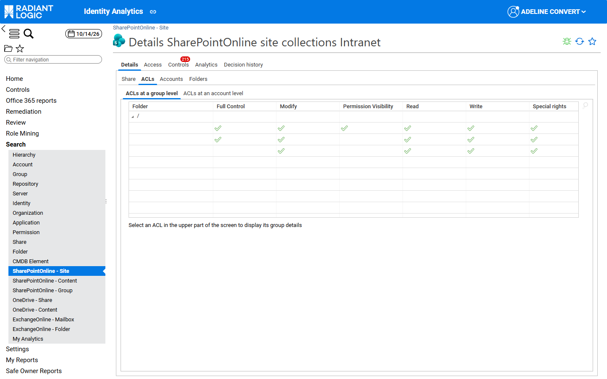
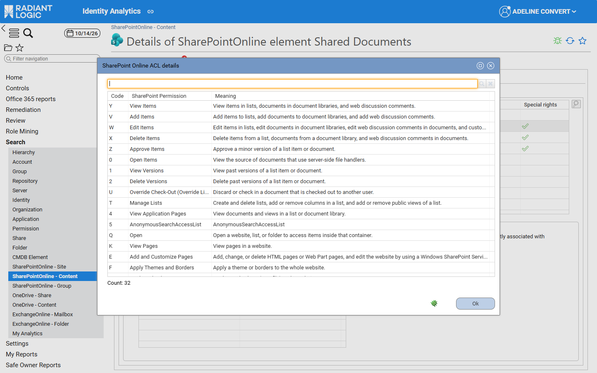

# SharePoint Online ACLs

This page describes how the SharePoint Online rights are displayed and how they are mapped to the ACL columns and counters. It is structured like the pages of the other workloads. The rules common to the three workloads are described in [ACLs and rights](/office-365/05-acl-and-rights/). The other workload pages are [Exchange Online ACLs](./02-exchange-online) and [OneDrive ACLs](./03-onedrive).

## Overview

Each SharePoint Online ACL is collected as a list of permission letters, one letter per permission (for example `YVWXZ…`). On share and folder detail pages, the **ACLs at a group level** and **ACLs at an account level** sections display them in the SharePoint Online columns: Full Control, Modify, Permission Visibility, Read, Write and Special rights. **Show Advanced Permissions** isn’t available for SharePoint Online.

## ACL columns

A column is ticked when the ACL contains **at least one** of the permissions listed for it, whatever their order (see [ACLs and rights](/office-365/05-acl-and-rights/#office-365-acls)).

| **Column**            | **SharePoint permissions (code)**                                                                                                                         | **Counter**                       |
| :-------------------- | :-------------------------------------------------------------------------------------------------------------------------------------------------------- | :-------------------------------- |
| Full Control          | Manage Permissions (A), Create Subsites (C), Manage Web Site (D)                                                                                          | Number of Full Control Access     |
| Modify                | Add and Customize Pages (E), Apply Themes and Borders (F), Apply Style Sheets (G), Create Groups (H), Browse Directories (I), Use Self-Service Site Creation (J), Manage Lists (T), Override Check-Out (U) | -                                 |
| Permission Visibility | Enumerate Permissions (L): the account can see who else has access to the site, list, folder or item                                                     | -                                 |
| Read                  | View Pages (K), View Items (Y), Open Items (0), View Versions (1), View Application Pages (4)                                                              | Number of Read Access             |
| Write                 | Add Items (V), Edit Items (W), Delete Items (X), Approve Items (Z)                                                                                         | Number of Write Access            |

The following permissions don’t tick any of these columns: View Web Analytics Data (B), Browse User Information (M), Manage Alerts (N), Use Remote Interfaces (O), Use Client Integration Features (P), Open (Q), Edit Personal User Information (R), AnonymousSearchAccessWebLists (S), Delete Versions (2), Create Alerts (3) and AnonymousSearchAccessList (5).

> **Note** SharePoint Online permission levels can be customised in each tenant. The columns follow Microsoft’s default permission levels, so a custom permission level can tick a column that its name doesn’t suggest. The **SharePoint Online ACL details** window always shows the exact permissions.

## Permission codes

| **Code** | **SharePoint Permission**                    | **Meaning**                                                                                                                                       | **Column** |
| :------: | :------------------------------------------- | :------------------------------------------------------------------------------------------------------------------------------------------------ | :--- |
| A        | Manage Permissions                           | Create and change permission levels on the website and assign permissions to users and groups.                                                  | Full Control |
| B        | View Web Analytics Data                      | View reports on website usage.                                                                                                                   | - |
| C        | Create Subsites                              | Create subsites such as team sites, Meeting Workspace sites, and Document Workspace sites.                                                       | Full Control |
| D        | Manage Web Site                              | Perform all administration tasks for the website, which includes managing content.                                                               | Full Control |
| E        | Add and Customize Pages                      | Add, change, or delete HTML pages or Web Part pages, and edit the website by using a Windows SharePoint Services-compatible editor.               | Modify |
| F        | Apply Themes and Borders                     | Apply a theme or borders to the whole website.                                                                                                   | Modify |
| G        | Apply Style Sheets                           | Apply a style sheet (.css file) to the website.                                                                                                  | Modify |
| H        | Create Groups                                | Create a group of users who can be used anywhere within the site collection.                                                                     | Modify |
| I        | Browse Directories                           | Enumerate files and folders in a website, by using an interface such as SharePoint Designer or web-based Distributed Authoring and Versioning (Web DAV). | Modify |
| J        | Use Self-Service Site Creation               | Create a website by using Self-Service Site Creation.                                                                                            | Modify |
| K        | View Pages                                   | View pages in a website.                                                                                                                         | Read |
| L        | Enumerate Permissions                        | Enumerate permissions on the website, list, folder, document, or list item.                                                                      | Permission Visibility |
| M        | Browse User Information                      | View information about users of the website.                                                                                                     | - |
| N        | Manage Alerts                                | Manage alerts for all users of the website                                                                                                       | - |
| O        | Use Remote Interfaces                        | Use Simple Object Access Protocol (SOAP), Web DAV, or SharePoint Designer interfaces to access the website.                                      | - |
| P        | Use Client Integration Features              | Use Client Integration Features                                                                                                                  | - |
| Q        | Open                                         | Open a website, list, or folder to access items inside that container.                                                                           | - |
| R        | Edit Personal User Information               | Allow a user to change personal information, such as adding a picture.                                                                           | - |
| S        | AnonymousSearchAccessWebLists                | AnonymousSearchAccessWebLists                                                                                                                    | - |
| T        | Manage Lists                                 | Create and delete lists, add or remove columns in a list, and add or remove public views of a list.                                              | Modify |
| U        | Override Check-Out (Override List Behaviors) | Discard or check in a document that is checked out to another user.                                                                              | Modify |
| V        | Add Items                                    | Add items to lists, add documents to document libraries, and add web discussion comments.                                                        | Write |
| W        | Edit Items                                   | Edit items in lists, edit documents in document libraries, edit web discussion comments in documents, and customize Web Part Pages in document libraries. | Write |
| X        | Delete Items                                 | Delete items from a list, documents from a document library, and web discussion comments in documents.                                           | Write |
| Y        | View Items                                   | View items in lists, documents in document libraries, and web discussion comments.                                                               | Read |
| Z        | Approve Items                                | Approve a minor version of a list item or document.                                                                                              | Write |
| 0        | Open Items                                   | View the source of documents that use server-side file handlers.                                                                                 | Read |
| 1        | View Versions                                | View past versions of a list item or document.                                                                                                   | Read |
| 2        | Delete Versions                              | Delete past versions of a list item or document.                                                                                                 | - |
| 3        | Create Alerts                                | Create e-mail alerts.                                                                                                                            | - |
| 4        | View Application Pages                       | View documents and views in a list or document library.                                                                                          | Read |
| 5        | AnonymousSearchAccessList                    | AnonymousSearchAccessList                                                                                                                        | - |

Codes S and 5 are displayed with their technical names: they make the content of the website lists (S) or of a list (5) available to anonymous search. Code P lets the account use features that launch client applications.

## ACL details window

The **SharePoint Online ACL details** window lists each permission of the selected ACL with the following columns: **Code**, **SharePoint Permission** and **Meaning**. A filter field at the top of the window lets the end user search for a permission.

## Counters

The read, write and full control counters of SharePoint Online (for example **Number of Read Access**) count the active accounts that hold at least one of the following letters, which are the letters of the corresponding ACL columns. There is no counter for the **Modify** and **Permission Visibility** columns. The differences between the counters and the ACL columns are described in [ACLs and rights](/office-365/05-acl-and-rights/#office-365-acls).

| **Counter** | **SharePoint Online** |
| :--------------------------- | :-------------------------- |
| `nbreadaccess` | `Y`, `K`, `4`, `0`, `1` |
| `nbwriteaccess` | `V`, `W`, `X`, `Z` |
| `nbfullcontrolaccess` | `A`, `C`, `D` |
| `nbviewaccess` | - |

## Sharing list and delegations

The **Sharing list** of the **Office 365** tab uses the same SharePoint Online columns, without **Special rights**, followed by the **ACL source** column (see [Office 365 tab](../04-office-365-tab#office-365-tab)). Delegations only exist for Exchange Online mailboxes.

## Integration

The **ACLs at a group level** and **ACLs at an account level** grids are defined in the fragment `fragmentSharedfolderAcls` (`/webportal/pages/bw_fragments/sharedfolder/acls.page`). For the share family `SharePointOnline`, the fragment selects the SharePoint Online columns and hides the **Show Advanced Permissions** checkbox.

Each SharePoint Online column is a `StringImageTemplate` applied to `action`, defined in `/webportal/pages/bw_office365/resources/resources.page`. A column is ticked when the regular expression matches, that is when `action` contains at least one letter of the class, in any order.

| **Column**            | **Template**                            | **Regular expression** |
| :-------------------- | :-------------------------------------- | :--------------------- |
| Full Control          | `spo_fullControlRightTemplate`          | `.*[ACD].*`            |
| Modify                | `spo_modifyRightTemplate`               | `.*[TEFGHIJU].*`       |
| Permission Visibility | `spo_permissionVisibilityRightTemplate` | `.*L.*`                |
| Read                  | `spo_readRightTemplate`                 | `.*[YK401].*`          |
| Write                 | `spo_writeRightTemplate`                | `.*[VWXZ].*`           |

The letter-to-permission dictionary used by the ACL details window is the mapping `bwf_spoFlagLetterToPermissionNLSMapper` in `/webportal/pages/bw_office365/resources/mappings.page`. The magnifier icon opens `bwf_sharepointonlineAclBreakdownDialog` (`/webportal/pages/bw_office365/resources/dialogs.page`), which splits the `action` of the selected ACL into single letters and translates each letter with that mapping. The labels and meanings are the NLS entries `bwf_advancedactions_NLS.sharepointonline.*` (`/webportal/pages/bw_fragments/sharedfolder/resources.page`).

The counters are computed by the `spo_sitemetrics` (sites) and `spo_foldermetrics` (lists and folders) metadata, described in [Metadata](../08-metadata-and-customization#metadata).

## Known limitations

- SharePoint Online permission levels can be customised in each tenant. The SharePoint Online columns group the SharePoint permissions according to Microsoft’s default permission levels, so a custom permission level can tick a column that its name doesn’t suggest (for example a custom “Read” level that also includes **Manage Lists** ticks **Modify**). Open the **SharePoint Online ACL details** window to see the exact permissions.
- In the **ACLs at a group level** section of SharePoint Online sites and content, the rights columns are wide enough to push the **Name**, **Group Code** and **Repository Name** columns out of view. Select an ACL to display the horizontal scrollbar, or read the group in the **Selected ACL group details** section.  
- SharePoint Online and Exchange Online folders opened from the generic **Folder** details page are displayed with the Windows columns. Open them from the Office 365 search pages to see the columns of their workload.

The known limitations of the whole module are listed in [Known limitations](../09-known-limitations).
