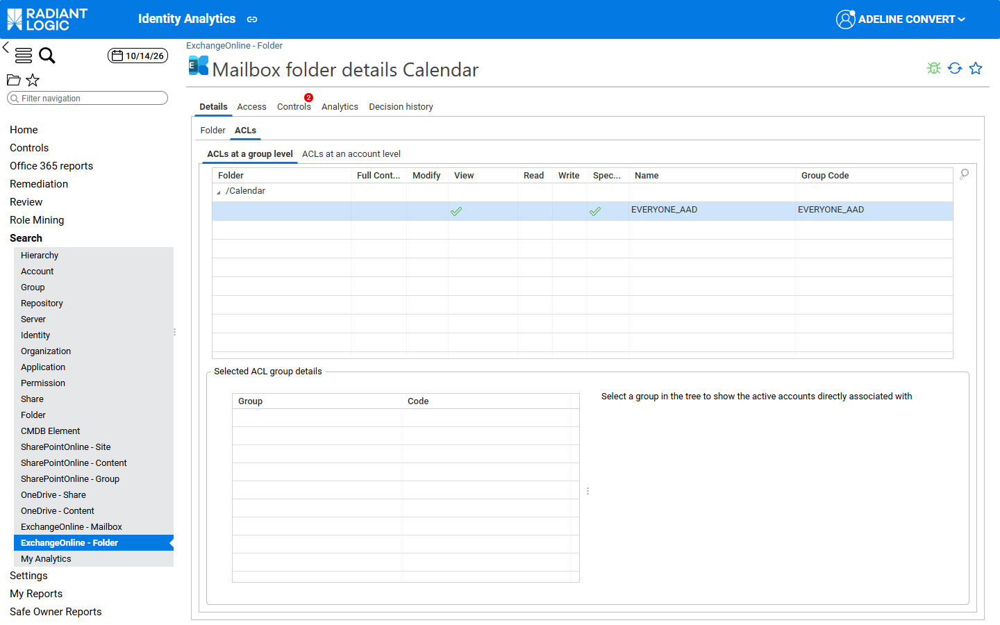
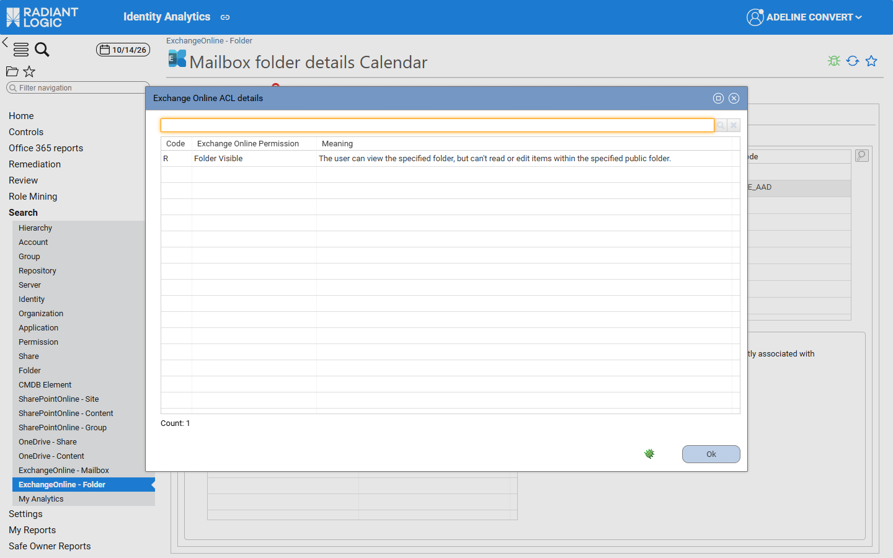

# Exchange Online ACLs

This page describes how the Exchange Online rights are displayed and how they are mapped to the ACL columns and counters. It is structured like the pages of the other workloads. The rules common to the three workloads are described in [ACLs and rights](/office-365/05-acl-and-rights/). The other workload pages are [SharePoint Online ACLs](./01-sharepoint-online) and [OneDrive ACLs](./03-onedrive).

## Overview

Each Exchange Online ACL is collected as a list of permission letters, one letter per permission. On share and folder detail pages, the **ACLs at a group level** and **ACLs at an account level** sections display them in the Exchange Online columns: Full Control, Modify, View, Read, Write and Special rights. **Show Advanced Permissions** isn’t available for Exchange Online.

An Exchange Online mailbox has two kinds of rights:

- **Folder permissions** (codes I to T), set on each folder of the mailbox (**/Calendar**, **/Inbox**, …). They are displayed in the ACL columns described below.
- **Mailbox delegations** (codes A to H), such as **Send As** or **Full Access**, set on the mailbox itself. They aren’t folder permissions: they are listed in the **Delegations** sub‑tab of the mailbox details page and counted by the **Number of Delegations** KPI. For more details, see [Mailbox details page](../03-search-and-detail-pages/03-exchange-online#mailbox-details-page).

## ACL columns

A column is ticked when the ACL contains **at least one** of the permissions listed for it, whatever their order (see [ACLs and rights](/office-365/05-acl-and-rights/#office-365-acls)).

| **Column**   | **Exchange Online folder permissions (code)**                                                              | **Counter**                    |
| :----------- | :--------------------------------------------------------------------------------------------------------- | :----------------------------- |
| Full Control | Folder Owner (P)                                                                                           | Number of Full Control Access  |
| Modify       | Edit All Items (M), Delete All Items (N), Create Subfolders (O)                                            | -                              |
| View         | Folder Visible (R)                                                                                         | Number of View Access          |
| Read         | Read Items (I)                                                                                             | Number of Read Access          |
| Write        | Create Items (J), Edit Owned Items (K), Delete Owned Items (L), Edit All Items (M), Delete All Items (N)    | Number of Write Access         |

Folder Contact (Q), Availability Only (S) and Limited Details (T) don’t tick any of these columns; S and T concern calendar folders.

Edit All Items (M) and Delete All Items (N) tick both **Modify** and **Write**. Folder Owner (P) only lets the account manage the folder itself: on its own, it doesn’t give access to the items, so an ACL that ticks **Full Control** without **Read** or **Write** belongs to an owner who can’t read the content of the folder.

**Read** deliberately doesn’t include **Create Items** (J): an account with the *Contributor* level can add items to a folder without reading its content, and is shown with **Write** but not **Read**.

With the Exchange Online folder permission levels, as collected for each folder, the columns are ticked as follows:

| **Permission level** | **Full Control** | **Modify** | **View** | **Read** | **Write** |
| :------------------- | :--------------: | :--------: | :------: | :------: | :-------: |
| Owner                | ✓                | ✓          | ✓        | ✓        | ✓         |
| PublishingEditor     |                  | ✓          | ✓        | ✓        | ✓         |
| Editor               |                  | ✓          | ✓        | ✓        | ✓         |
| PublishingAuthor     |                  | ✓          | ✓        | ✓        | ✓         |
| Author               |                  |            | ✓        | ✓        | ✓         |
| NonEditingAuthor     |                  |            | ✓        | ✓        | ✓         |
| Reviewer             |                  |            | ✓        | ✓        |           |
| Contributor          |                  |            | ✓        |          | ✓         |
| None                 |                  |            | ✓        |          |           |

## Permission codes

| **Code** | **Exchange Online Permission** | **Meaning**                                                                                                                                                  | **Column** |
| :------: | :----------------------------- | :----------------------------------------------------------------------------------------------------------------------------------------------------------- | :--- |
| I        | Read Items                     | The user can read items within the specified folder.                                                                                                         | Read |
| J        | Create Items                   | The user can create items within the specified folder.                                                                                                       | Write |
| K        | Edit Owned Items               | The user can only edit items that they created in the specified folder.                                                                                      | Write |
| L        | Delete Owned Items             | The user can only delete items that they created from the specified folder.                                                                                  | Write |
| M        | Edit All Items                 | The user can edit all items in the specified folder.                                                                                                         | Modify, Write |
| N        | Delete All Items               | The user can delete all items in the specified folder.                                                                                                       | Modify, Write |
| O        | Create Subfolders              | The user can create subfolders in the specified folder.                                                                                                      | Modify |
| P        | Folder Owner                   | The user is the owner of the specified folder. The user can view the folder, move the folder and create subfolders. The user can’t read items, edit items, delete items or create items. | Full Control |
| Q        | Folder Contact                 | The user is the contact for the specified public folder.                                                                                                     | - |
| R        | Folder Visible                 | The user can view the specified folder, but can’t read or edit items within the specified public folder.                                                     | View |
| S        | Availability Only              | View only availability data.                                                                                                                                 | - |
| T        | Limited Details                | View availability data with subject and location.                                                                                                            | - |

## ACL details window

The **Exchange Online ACL details** window lists each permission of the selected ACL with the following columns: **Code**, **Exchange Online Permission** and **Meaning**.

## Counters

The read, write, full control and view counters of Exchange Online (for example **Nb. of Read Access** or **Nb. of View Access**) count the active accounts that hold at least one of the following letters, which are the letters of the corresponding ACL columns. There is no counter for the **Modify** column. The differences between the counters and the ACL columns are described in [ACLs and rights](/office-365/05-acl-and-rights/#office-365-acls). The number of delegations of a mailbox is described in [Sharing list and delegations](#sharing-list-and-delegations).

| **Counter** | **Exchange Online** |
| :--------------------------- | :--------------------------- |
| `nbreadaccess` | `I` |
| `nbwriteaccess` | `J`, `K`, `L`, `M`, `N` |
| `nbfullcontrolaccess` | `P` |
| `nbviewaccess` | `R` |

## Sharing list and delegations

The **Sharing list** of the **Office 365** tab uses the same Exchange Online columns, without **Special rights**, followed by the **ACL source** column (see [Office 365 tab](../04-office-365-tab#office-365-tab)).

### Delegations

The mailbox delegations use the following codes. They are displayed with their label in the **Access type** column of the **Delegations** sub‑tab:

| **Code** | **Access type**   |
| :------: | :---------------- |
| A        | Send As           |
| B        | Send on Behalf    |
| C        | Full Access       |
| D        | Change Owner      |
| E        | Change Permission |
| F        | Delete Item       |
| G        | Read Permission   |
| H        | External Account  |

## Integration

The **ACLs at a group level** and **ACLs at an account level** grids are defined in the fragment `fragmentSharedfolderAcls` (`/webportal/pages/bw_fragments/sharedfolder/acls.page`). For the share family `ExchangeOnline`, the fragment selects the Exchange Online columns and hides the **Show Advanced Permissions** checkbox.

Each Exchange Online column is a `StringImageTemplate` applied to `action`, defined in `/webportal/pages/bw_office365/resources/resources.page`. A column is ticked when the regular expression matches, that is when `action` contains at least one letter of the class, in any order.

| **Column**   | **Template**                   | **Regular expression** |
| :----------- | :----------------------------- | :--------------------- |
| Full Control | `eol_fullControlRightTemplate` | `.*P.*`                |
| Modify       | `eol_modifyRightTemplate`      | `.*[MNO].*`            |
| View         | `eol_viewRightTemplate`        | `.*R.*`                |
| Read         | `eol_readRightTemplate`        | `.*I.*`                |
| Write        | `eol_writeRightTemplate`       | `.*[JKLMN].*`          |

Mailbox-level delegations (Send As, Full Access…) use another set of letters on a pseudo-folder; see [Mailbox delegations](#mailbox-delegations).

The letter-to-permission dictionary used by the ACL details window is the mapping `bwf_eolFlagLetterToPermissionNLSMapper` in `/webportal/pages/bw_office365/resources/mappings.page`. The magnifier icon opens `bwf_exchangeonlineAclBreakdownDialog` (`/webportal/pages/bw_office365/resources/dialogs.page`), which splits the `action` of the selected ACL into single letters and translates each letter with that mapping. The labels and meanings are the NLS entries `bwf_advancedactions_NLS.exchangeonline.*` (`/webportal/pages/bw_fragments/sharedfolder/resources.page`).

The counters are computed by the `eol_mailboxmetrics` (mailboxes) and `eol_foldermetrics` (mailbox folders) metadata, described in [Metadata](../08-metadata-and-customization#metadata).

### Mailbox delegations

Mailbox delegations are rights on the pseudo-folder `/$BW_MAIL_BOX_RIGHTS$` of each mailbox, whose permission type is `UserMailbox` or `SharedMailbox`. Each right contains one delegation letter, from `A` to `H`. For the access type of each letter, see [Exchange Online ACLs](#exchange-online-acls).

- `eol_mailboxmetrics_nbdelegation` (`nbdelegation`) counts the distinct accounts that hold a right on the pseudo-folder. Unlike the other counters, it doesn’t exclude disabled accounts.
- The **Delegations** sub‑tab (`fragmentShareDelegations`, `/webportal/pages/bw_fragments/share/delegations.page`) is displayed when `nbdelegation` is greater than 0.
- The Exchange Online controls use `A` (Send As), `B` (Send on Behalf) and `C` (Full Access). For more details, see [Office 365 controls](../06-controls#control-reference).
- The pseudo-folder and the mailbox root (*Top of Information Store*) aren’t counted in the `nbfolder` and `nbmanagedfolder` metadata of the mailbox.

## Known limitations

- SharePoint Online and Exchange Online folders opened from the generic **Folder** details page are displayed with the Windows columns. Open them from the Office 365 search pages to see the columns of their workload.
- In the **Delegations** tab of the **Mailbox detail** window, the **Mailbox type** column shows the raw value (for example `SharedMailbox`).

The known limitations of the whole module are listed in [Known limitations](../09-known-limitations).
