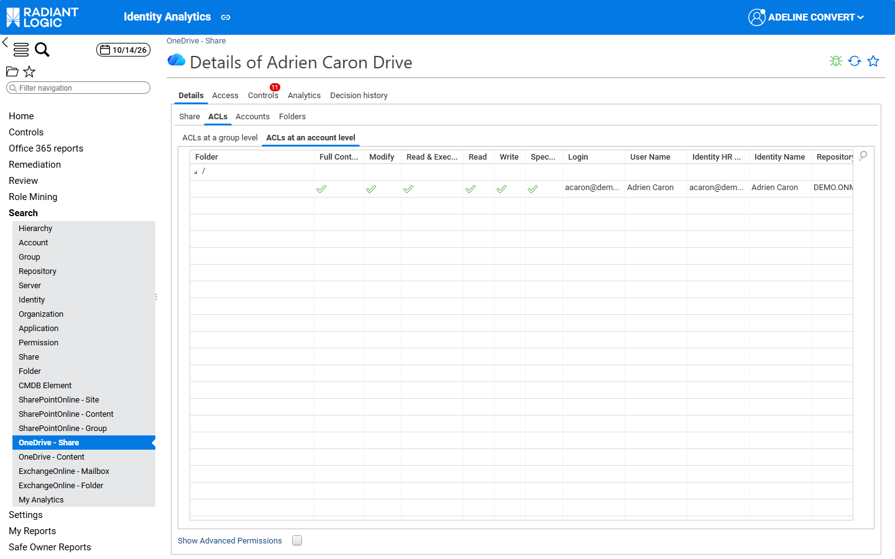

# OneDrive ACLs

This page describes how the OneDrive rights are displayed and how they are mapped to the ACL columns and counters. It is structured like the pages of the other workloads. The rules common to the three workloads are described in [ACLs and rights](/office-365/05-acl-and-rights/). The other workload pages are [SharePoint Online ACLs](./01-sharepoint-online) and [Exchange Online ACLs](./02-exchange-online).

## Overview

OneDrive rights are collected with the same letters as Windows file system rights. They are therefore displayed with the standard basic ACL columns, and the end user can select **Show Advanced Permissions** to display the advanced ACLs. For the meaning of each letter, see [Basic ACLs](../../identity-analytics/enduser-guide/06-acl#basic-acls) and [Advanced ACLs](../../identity-analytics/enduser-guide/06-acl#advanced-acls). The read, write and full control counters of OneDrive drives, files and folders are computed as for Windows shares and folders.

On share and folder detail pages, OneDrive ACLs use the same display as any other share family: the standard Windows columns (see [ACLs and rights](/office-365/05-acl-and-rights/#office-365-acls)).

## ACL columns

OneDrive ACLs are displayed with the standard basic ACL columns, and the end user can select **Show Advanced Permissions** to display the advanced ACLs. A column is ticked only when the ACL holds **every** code it requires (see [Permission codes](#permission-codes)).

## Permission codes

The codes of OneDrive rights and the basic columns that require them (a column is ticked only when the ACL holds every code it requires):

| **Code** | **Windows right** | **Required for** |
| :------: | :--- | :--- |
| `R` | Read data | Full Control, Modify, Read & Execute, Read |
| `W` | Write data | Full Control, Modify, Write |
| `A` | Append data | Full Control, Modify, Write |
| `X` | Execute | Full Control, Modify, Read & Execute |
| `E` | Read attributes | Full Control, Modify, Read & Execute, Read |
| `L` | Write attributes | Full Control, Modify, Write |
| `F` | Read extended attributes | Full Control, Modify, Read & Execute, Read |
| `M` | Write extended attributes | Full Control, Modify, Write |
| `D` | Delete | Full Control, Modify |
| `S` | Delete child | Full Control |
| `G` | Read control (read permissions) | Full Control, Modify, Read & Execute, Read, Write |
| `P` | Write DAC (change permissions) | Full Control |
| `O` | Write owner (take ownership) | Full Control |

## ACL details window

In the **Sharing list** of the **Office 365** tab, the magnifier icon opens the **OneDrive ACL details** window, which lists each Windows right of the ACL with its **Code**, **Permission** and **Meaning**.

## Counters

OneDrive drives, files and folders use the standard counters of the product (`bwa_applicationanalytics`, `bwa_permissionanalytics`), computed as for Windows shares. The views of the Office 365 counters also contain OneDrive filters, but no Office 365 metadata uses them.

## Sharing list and delegations

In the **Sharing list** of the **Office 365** tab, OneDrive ACLs are displayed with the same columns, except **Special rights**. Delegations only exist for Exchange Online mailboxes.

## Integration

The **ACLs at a group level** and **ACLs at an account level** grids are defined in the fragment `fragmentSharedfolderAcls` (`/webportal/pages/bw_fragments/sharedfolder/acls.page`), which selects the Windows columns for any share family other than `SharePointOnline` and `ExchangeOnline`, including OneDrive. The **Show Advanced Permissions** checkbox stays available.

The **Sharing list** of the **Office 365** tab (`O365_aclDetailsFragment`, `/webportal/pages/bw_office365/resources/fragments.page`) uses the same SharePoint Online and Exchange Online templates, without **Special rights**. For OneDrive, it uses `onedrive_*RightTemplate` templates that tick a column only when `action` contains **all** the letters of the Windows basic permission:

| **Template**                         | **Column**     | **Letters required**                        |
| :----------------------------------- | :------------- | :------------------------------------------ |
| `onedrive_fullControlRightTemplate`  | Full Control   | `A`, `D`, `E`, `F`, `G`, `L`, `M`, `O`, `P`, `R`, `S`, `W`, `X` |
| `onedrive_modifyRightTemplate`       | Modify         | `A`, `D`, `E`, `F`, `G`, `L`, `M`, `R`, `W`, `X` |
| `onedrive_readExecuteRightTemplate`  | Read & Execute | `E`, `F`, `G`, `R`, `X`                     |
| `onedrive_readRightTemplate`         | Read           | `E`, `F`, `G`, `R`                          |
| `onedrive_writeRightTemplate`        | Write          | `A`, `G`, `L`, `M`, `W`                     |

OneDrive rights use the Windows codes, with their Windows meaning (`bwf_sharedfolder_rights.explained.*`). For the meaning of each code, see [OneDrive ACLs](#onedrive-acls).

The magnifier icon of the Sharing list opens `bwf_onedriveAclBreakdownDialog` (`/webportal/pages/bw_office365/resources/dialogs.page`). The OneDrive labels are the Windows rights labels (`bwf_sharedfolder_helpNLS`).

## Known limitations

- OneDrive rights are displayed with the standard Windows columns, because OneDrive rights are collected with the same letters as Windows file system rights.
- In the **OneDrive** tab and the **OneDrive tree**, the **Permission details** of the root of a drive show the type **Share**, while the tree shows **Root**.

The known limitations of the whole module are listed in [Known limitations](../09-known-limitations).
