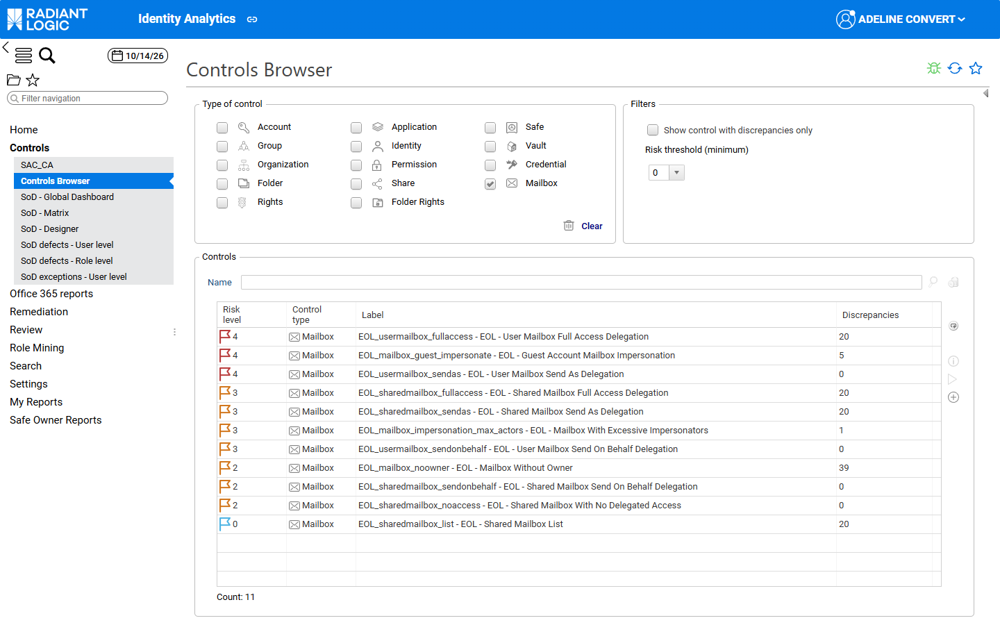

# Office 365 controls

This page describes the Office 365 controls, their parameters and their display in the Controls Browser.

## Controls

Identity Analytics includes 22 controls: 8 for SharePoint Online, 12 for Exchange Online and 2 for OneDrive. They are executed only when `isOffice365Active` is `true`. For the description and risk level of each control, see [Office 365 controls](#control-reference).

Each control has the following tags, which you can use to filter them, for example in your own dashboards:

| **Tag**   | **Values**                                                                                                                                  |
| :-------- | :------------------------------------------------------------------------------------------------------------------------------------------ |
| `family`  | `SharePointOnline`, `ExchangeOnline` or `OneDrive`                                                                                          |
| `scope`   | `Share` (sites and drives), `Sharedfolder` (lists, folders and files), `Mailbox` (Exchange Online mailboxes) or `Identity` (`EOL_user_impersonate_max_mailbox`) |
| `custom9` | `SPO1` to `SPO8`, `EOL1` to `EOL12`, `ONEDRIVE1` to `ONEDRIVE2` |

The `scope` tag gives the **Control type** shown in the Controls Browser. For more details, see [Office 365 controls in the Controls Browser](#office-365-controls-in-the-controls-browser).

The display names of the controls are translated through `/localisation/bw_office365/office365_<lang>.properties`, with the key `Control.displayName.<control name>` (for example `Control.displayName.EOL_mailbox_noowner`). If you add a language or rename a control, add the corresponding key.

Some controls use parameters that you can adapt:

| **Control**                              | **Parameter**                        | **Default value** | **Effect**                                                                               |
| :--------------------------------------- | :----------------------------------- | :---------------- | :--------------------------------------------------------------------------------------- |
| `EOL_mailbox_impersonation_max_actors`   | `max_impersonation`                  | `5`               | Minimum number of accounts with **Send As** or **Full Access** on a mailbox               |
| `EOL_user_impersonate_max_mailbox`       | `max_mailbox`                        | `5`               | Minimum number of mailboxes on which an identity has **Send As** or **Full Access**       |
| `SPO_inheritance_lvl1`                   | `folderdepth_min`, `folderdepth_max` | `2`, `2`          | Folder depth of the elements checked (**Depth 1**)                                       |
| `SPO_inheritance_lvl2`                   | `folderdepth_min`, `folderdepth_max` | `3`, `4`          | Folder depth of the elements checked (**Depth 2-3**)                                     |
| `SPO_inheritance_lvl3`                   | `folderdepth_min`, `folderdepth_max` | `5`, `100`        | Folder depth of the elements checked (**Depth 4+**)                                      |

The parameters filter the folder depth of the SharePoint Online elements, shown in the **Folder depth** column of the Office 365 resource windows. In this folder depth, the site root counts as level 1: the lists and libraries directly below the site root are at folder depth 2, their folders at folder depth 3, and so on. The display names of the SharePoint Online controls count the levels below the site root instead: **Depth 1** checks the elements at folder depth 2 (lists and libraries), **Depth 2-3** the elements at folder depth 3 and 4, and **Depth 4+** the elements at folder depth 5 and deeper.  

### Control reference

When the configuration variable `isOffice365Active` is set to `true` (see [Activation](./02-prerequisites-and-activation#activation)), the following additional controls are executed. Their results are presented in the dashboards of the **Office 365 reports** menu. For more details, see [Office 365 reports](./07-dashboards-and-reports#office-365-reports).

The Exchange Online controls only consider Exchange Online applications of type `Filesystem`. Guest accounts are Microsoft Entra ID accounts with the value `Guest` in the `custom1` attribute, and `EVERYONE_AAD` is the public group of the tenant.

#### SharePoint Online controls

---

- **Control ID:** `SPO_direct_control_not_owner`
- **Entity:** Permission
- **Name:** SPO - Direct Full Access Without Site Owner
- **Description:** An account holds, through an ACL granted directly to it, the complete set of SharePoint Online permissions (*Full Control*) on a site element, and its identity isn’t the owner of the site.
- **Risk Level:** 4
- **Risk description:** User holds full direct access on a SharePoint Online node without being the designated site owner, bypassing the standard delegation model.

---

- **Control ID:** `SPO_guest_access`
- **Entity:** Permission
- **Name:** SPO - Guest Account With Write Access
- **Description:** A guest account holds an ACL granted directly to it with the **Add Items** (`V`) or **Edit Items** (`W`) permission on a SharePoint Online element.
- **Risk Level:** 3
- **Risk description:** External guest account holds write permissions on a SharePoint Online site, allowing content modification by a non-managed identity.

---

- **Control ID:** `SPO_inheritance_lvl1`
- **Entity:** Permission
- **Name:** SPO - Broken Inheritance - Depth 1
- **Description:** SharePoint Online element at the first level below the site root (folder depth 2, the lists and libraries) whose permissions aren’t inherited from its parent. The folder depth is set by the `folderdepth_min` and `folderdepth_max` parameters.
- **Risk Level:** 1
- **Risk description:** Broken inheritance at list or subsite level - permissions diverge from the site collection root, creating a governance boundary that must be reviewed independently.

---

- **Control ID:** `SPO_inheritance_lvl2`
- **Entity:** Permission
- **Name:** SPO - Broken Inheritance - Depth 2-3
- **Description:** SharePoint Online element at the second or third level below the site root (folder depth 3 or 4) whose permissions aren’t inherited from its parent. The folder depth is set by the `folderdepth_min` and `folderdepth_max` parameters.
- **Risk Level:** 2
- **Risk description:** Broken inheritance inside a list or subsite - a custom permission grant exists below the expected governance boundary, increasing the risk of undocumented access.

---

- **Control ID:** `SPO_inheritance_lvl3`
- **Entity:** Permission
- **Name:** SPO - Broken Inheritance - Depth 4+
- **Description:** SharePoint Online element at the fourth level below the site root or deeper (folder depth 5 to 100) whose permissions aren’t inherited from its parent. The folder depth is set by the `folderdepth_min` and `folderdepth_max` parameters.
- **Risk Level:** 4
- **Risk description:** Broken inheritance deep in the content tree - permissions were set directly on nested content, typically by contributors rather than administrators, with low visibility and high likelihood of access creep.

In the folder depth, shown in the **Folder depth** column of the Office 365 resource windows, the site root counts as level 1. The depth in the name of the controls counts the levels below the site root. For more details, see [Controls](#controls).

---

- **Control ID:** `SPO_node_no_owner`
- **Entity:** Application
- **Name:** SPO - Site Node Without Owner
- **Description:** SharePoint Online site without a manager (business owner or technical owner).
- **Risk Level:** 3
- **Risk description:** SharePoint Online site or node has no designated owner, leaving access governance unaccountable and site management orphaned.

---

- **Control ID:** `SPO_public_group_access`
- **Entity:** Application
- **Name:** SPO - Public Group Access on Site
- **Description:** SharePoint Online site on which a group that contains the public group `EVERYONE_AAD` holds an ACL.
- **Risk Level:** 2
- **Risk description:** SharePoint Online node is accessible via a public group, granting access to all group members without individual entitlement review.

---

- **Control ID:** `SPO_direct_user_access`
- **Entity:** Permission
- **Name:** SPO - Permission Granted Directly to User
- **Description:** SharePoint Online element with non-inherited permissions on which an ACL is granted directly to an account instead of a group.
- **Risk Level:** 2
- **Risk description:** SharePoint Online permission is granted directly to an individual user instead of through a group, breaking the standard delegation model and creating ungoverned individual entitlements.

#### Exchange Online controls

---

- **Control ID:** `EOL_mailbox_guest_impersonate`
- **Entity:** Application
- **Name:** EOL - Guest Account Mailbox Impersonation
- **Description:** An active guest account holds **Send As** or **Full Access** on a user or shared mailbox.
- **Risk Level:** 4
- **Risk description:** An external guest account holds impersonation rights on an Exchange Online mailbox, allowing it to send and read emails as an internal user.

---

- **Control ID:** `EOL_mailbox_impersonation_max_actors`
- **Entity:** Application
- **Name:** EOL - Mailbox With Excessive Impersonators
- **Description:** Mailbox on which 5 or more active accounts hold **Send As** or **Full Access**. The threshold is set by the `max_impersonation` parameter.
- **Risk Level:** 3
- **Risk description:** Exchange Online mailbox has 5 or more accounts with impersonation rights, indicating excessive delegation that is difficult to audit and control.

---

- **Control ID:** `EOL_mailbox_noowner`
- **Entity:** Application
- **Name:** EOL - Mailbox Without Owner
- **Description:** Exchange Online mailbox without a manager (business owner or technical owner).
- **Risk Level:** 2
- **Risk description:** Exchange Online mailbox has no designated owner, making access accountability unclear and governance reviews incomplete.

---

- **Control ID:** `EOL_sharedmailbox_fullaccess`
- **Entity:** Application
- **Name:** EOL - Shared Mailbox Full Access Delegation
- **Description:** An account holds **Full Access** on a shared mailbox.
- **Risk Level:** 3
- **Risk description:** Account holds FullAccess permission on a shared mailbox, enabling complete read and management of all messages in the mailbox.

---

- **Control ID:** `EOL_sharedmailbox_list`
- **Entity:** Application
- **Name:** EOL - Shared Mailbox List
- **Description:** Informational control: lists every shared mailbox of the tenant. Each shared mailbox is reported, with a risk level of 0.
- **Risk Level:** 0
- **Risk description:** Informational control with no associated risk: lists the shared mailboxes of the Exchange Online tenant to provide an inventory that supports governance reviews.

---

- **Control ID:** `EOL_sharedmailbox_noaccess`
- **Entity:** Application
- **Name:** EOL - Shared Mailbox With No Delegated Access
- **Description:** Shared mailbox on which no active account holds a delegation, including shared mailboxes with no delegation at all.
- **Risk Level:** 2
- **Risk description:** Shared mailbox has no active accounts with delegated access, making it an unmonitored orphaned resource in the tenant.

---

- **Control ID:** `EOL_sharedmailbox_sendas`
- **Entity:** Application
- **Name:** EOL - Shared Mailbox Send As Delegation
- **Description:** An account holds **Send As** on a shared mailbox.
- **Risk Level:** 3
- **Risk description:** Account can send emails as the shared mailbox identity, fully impersonating the mailbox address to all recipients without disclosure.

---

- **Control ID:** `EOL_sharedmailbox_sendonbehalf`
- **Entity:** Application
- **Name:** EOL - Shared Mailbox Send On Behalf Delegation
- **Description:** An account holds **Send on Behalf** on a shared mailbox.
- **Risk Level:** 2
- **Risk description:** Account can send emails on behalf of the shared mailbox, with the delegated sender identity disclosed to recipients.

---

- **Control ID:** `EOL_usermailbox_fullaccess`
- **Entity:** Application
- **Name:** EOL - User Mailbox Full Access Delegation
- **Description:** An account holds **Full Access** on a personal (user) mailbox.
- **Risk Level:** 4
- **Risk description:** Account holds FullAccess delegation on a personal user mailbox, allowing unrestricted reading and management of all private communications.

---

- **Control ID:** `EOL_usermailbox_sendas`
- **Entity:** Application
- **Name:** EOL - User Mailbox Send As Delegation
- **Description:** An account holds **Send As** on a personal (user) mailbox.
- **Risk Level:** 4
- **Risk description:** Account can send emails as the personal user mailbox identity, fully impersonating the user to all external and internal recipients.

---

- **Control ID:** `EOL_usermailbox_sendonbehalf`
- **Entity:** Application
- **Name:** EOL - User Mailbox Send On Behalf Delegation
- **Description:** An account holds **Send on Behalf** on a personal (user) mailbox.
- **Risk Level:** 3
- **Risk description:** Account can send emails on behalf of a personal user mailbox, with the delegated sender identity disclosed to recipients.

---

- **Control ID:** `EOL_user_impersonate_max_mailbox`
- **Entity:** Identity
- **Name:** EOL - User With Access to Excessive Mailboxes
- **Description:** Identity holding **Send As** or **Full Access** on 5 or more mailboxes. The threshold is set by the `max_mailbox` parameter.
- **Risk Level:** 3
- **Risk description:** A single account holds impersonation rights on more than 5 mailboxes, indicating abnormal delegation breadth that represents a lateral movement risk.

#### OneDrive controls

---

- **Control ID:** `OneDrive_public_access`
- **Entity:** Application
- **Name:** OneDrive - Public Access to Drive Content
- **Description:** OneDrive drive with an element whose ACL is granted to the public group `EVERYONE_AAD`.
- **Risk Level:** 4
- **Risk description:** OneDrive content is accessible via a public or organization-wide sharing link, exposing personal drive files beyond the intended audience.

---

- **Control ID:** `OneDrive_no_owner`
- **Entity:** Application
- **Name:** OneDrive - Drive Without Owner
- **Description:** OneDrive drive without a manager (business owner or technical owner).
- **Risk Level:** 3
- **Risk description:** OneDrive drive has no designated owner, leaving the drive ungoverned with no accountable party for access reviews or offboarding cleanup.

---

## Office 365 controls in the Controls Browser

The Office 365 controls are also listed in the **Controls Browser** (**Controls → Controls Browser**), with their risk level and number of discrepancies, next to the other controls of the project. Their **Control type** shows what they check: **Mailbox** for the Exchange Online mailbox controls, **Share** for the SharePoint Online and OneDrive controls that check sites and drives, and **Shared Folder** for those that check their content.

To list the Exchange Online mailbox controls only, select **Mailbox** in the **Type of control** section. The **Controls** table then lists the 11 Exchange Online mailbox controls, all with the **Mailbox** control type, so that you can check at a glance which ones have discrepancies.

