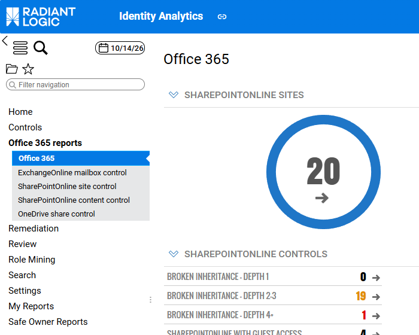
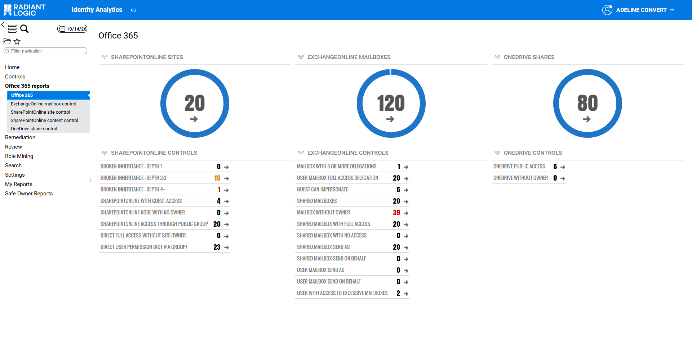
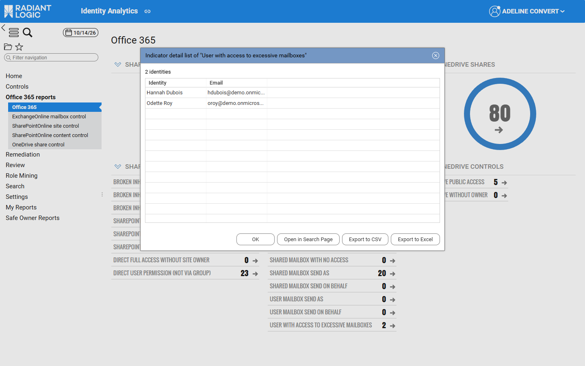
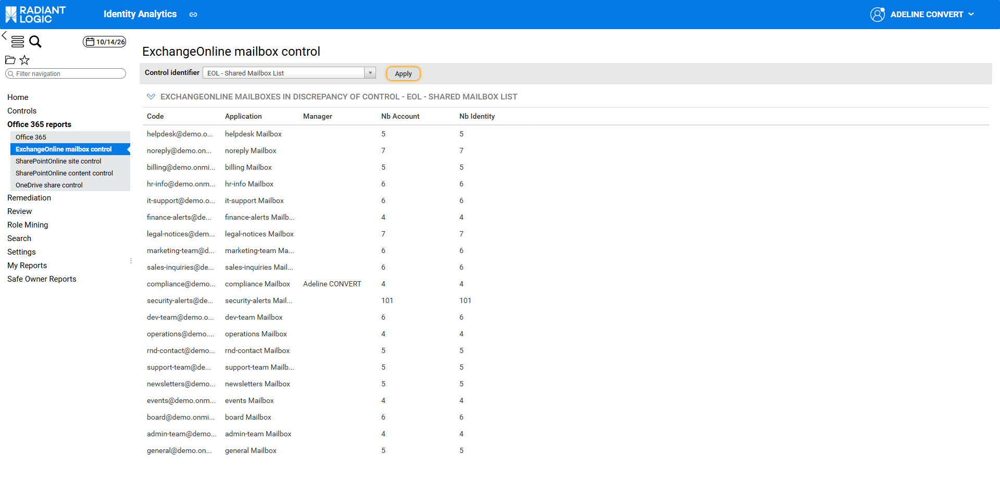
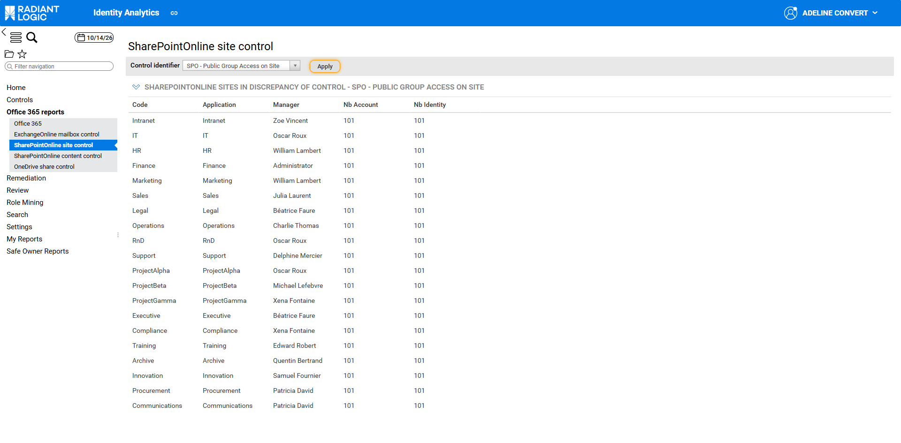
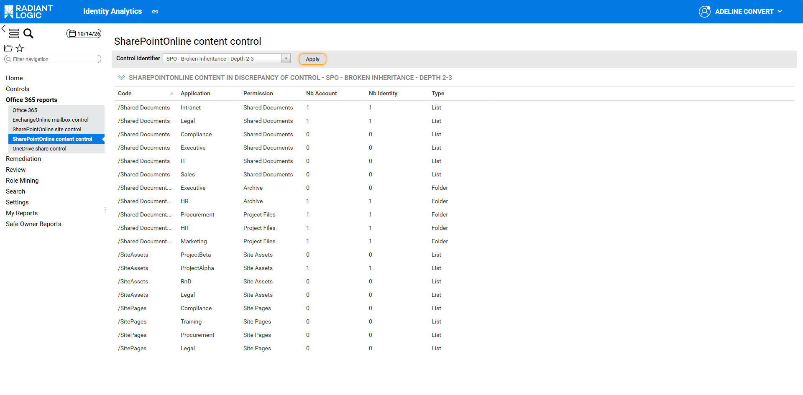
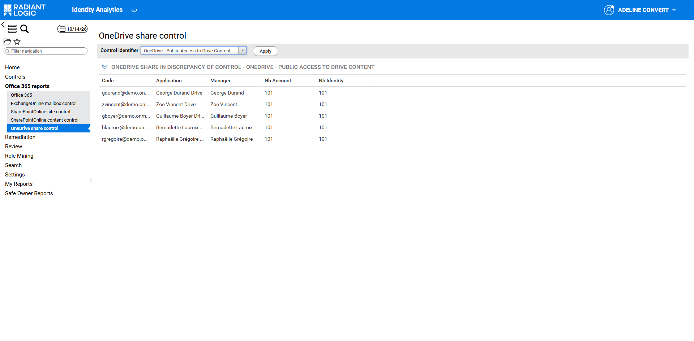

# Dashboards and reports

This page describes the Office 365 reports menu, its dashboards, how to publish them, and the Office 365 analytics reports.

## Office 365 reports

### Access

The **Office 365 reports** section of the left‑hand menu contains five dashboards: an overview of the Microsoft 365 workloads and of the results of the Office 365 controls, and one dashboard per workload that lists the items in discrepancy for a selected control. The dashboards aren’t shared by default: they appear in this section only once they have been shared with the end user, as described in the introduction of this page. The following screenshot shows the section once the dashboards are shared.  

| **Menu entry**                    | **Content**                                                                                     |
| :-------------------------------- | :---------------------------------------------------------------------------------------------- |
| Office 365                        | Number of sites, mailboxes and drives, and number of discrepancies of each Office 365 control  |
| ExchangeOnline mailbox control    | Exchange Online mailboxes in discrepancy for the selected Exchange Online control               |
| SharePointOnline site control     | SharePoint Online sites in discrepancy for the selected site‑level control                      |
| SharePointOnline content control  | SharePoint Online lists and folders in discrepancy for the selected content‑level control       |
| OneDrive share control            | OneDrive drives in discrepancy for the selected OneDrive control                                |

The values of the dashboards come from the last execution of the Office 365 controls. For the list of controls, see [Office 365 controls](./06-controls#control-reference).

### Office 365 dashboard

The **Office 365** dashboard gives, in one screen, the size of each workload and the number of discrepancies of each Office 365 control. Use it to spot the controls with the most discrepancies and drill down to the affected items.

The dashboard has three columns, one per workload:

1. The first row shows the number of **SharePointOnline sites**, **ExchangeOnline mailboxes** and **OneDrive shares**, with an arrow showing their trend since the previous timeslot.
2. The **SharePointOnline controls**, **ExchangeOnline controls** and **OneDrive controls** sections show, for each control, the number of items in discrepancy, with their trend. Some indicators turn orange or red when they reach a warning or critical threshold.

| **Section**               | **Indicator**                                  | **Control**                                       |
| :------------------------ | :--------------------------------------------- | :------------------------------------------------ |
| SharePointOnline controls | Broken inheritance - depth 1                   | SPO - Broken Inheritance - Depth 1                |
|                           | Broken inheritance - depth 2-3                 | SPO - Broken Inheritance - Depth 2-3              |
|                           | Broken inheritance - depth 4+                  | SPO - Broken Inheritance - Depth 4+               |
|                           | SharePointOnline with guest access             | SPO - Guest Account With Write Access             |
|                           | SharePointOnline node with no owner            | SPO - Site Node Without Owner                     |
|                           | SharePointOnline access through public group   | SPO - Public Group Access on Site                 |
|                           | Direct full access without site owner          | SPO - Direct Full Access Without Site Owner       |
|                           | Direct user permission (not via group)         | SPO - Permission Granted Directly to User         |
| ExchangeOnline controls   | Mailbox with 5 or more delegations             | EOL - Mailbox With Excessive Impersonators        |
|                           | User mailbox full access delegation            | EOL - User Mailbox Full Access Delegation         |
|                           | Guest can impersonate                          | EOL - Guest Account Mailbox Impersonation         |
|                           | Shared mailboxes                               | EOL - Shared Mailbox List                         |
|                           | Mailbox without owner                          | EOL - Mailbox Without Owner                       |
|                           | Shared mailbox with full access                | EOL - Shared Mailbox Full Access Delegation       |
|                           | Shared mailbox with no access                  | EOL - Shared Mailbox With No Delegated Access     |
|                           | Shared mailbox send as                         | EOL - Shared Mailbox Send As Delegation           |
|                           | Shared mailbox send on behalf                  | EOL - Shared Mailbox Send On Behalf Delegation    |
|                           | User mailbox send as                           | EOL - User Mailbox Send As Delegation             |
|                           | User mailbox send on behalf                    | EOL - User Mailbox Send On Behalf Delegation      |
|                           | User with access to excessive mailboxes        | EOL - User With Access to Excessive Mailboxes     |
| OneDrive controls         | OneDrive public access                         | OneDrive - Public Access to Drive Content         |
|                           | OneDrive without owner                         | OneDrive - Drive Without Owner                    |

The **Shared mailboxes** indicator is an inventory, not a risk: its control lists all shared mailboxes so that they can be reviewed.

Clicking the value of a control indicator opens the control dashboard of the workload, with the **Control identifier** set to that control. For more details, see [Control dashboards](#control-dashboards).

Clicking the value of **User with access to excessive mailboxes**, which counts identities rather than mailboxes, opens the **Indicator detail list of “User with access to excessive mailboxes”** window instead. It lists the identities with their **Identity** and **Email**. From this window, the end user can click **Open in Search Page** to continue the analysis in a search page, or export the list with **Export to CSV** or **Export to Excel**.

Clicking one of the counters of the first row opens the indicator detail list of the sites, mailboxes or drives.

### Control dashboards

The **ExchangeOnline mailbox control**, **SharePointOnline site control**, **SharePointOnline content control** and **OneDrive share control** dashboards list the items in discrepancy for one control at a time. Use them to go from a control result to the items that must be fixed, and from each item to its detail page.

The four dashboards work the same way:

1. Select a control in the **Control identifier** combobox. Only the controls of the workload and level of the dashboard that have been executed are listed.
2. Click **Apply**.
3. The table below lists the items in discrepancy for the selected control. Its title gives the control name, for example **ExchangeOnline mailboxes in discrepancy of control - EOL - Shared Mailbox List**. The table is empty when the control has no discrepancy.
4. Click a value in the **Code** column to open the Office 365 detail page of the item.

| **Dashboard**                    | **Controls available**                                                                                                                       | **Selected by default**                      | **Columns**                                                           | **Clicking Code opens**        |
| :------------------------------- | :------------------------------------------------------------------------------------------------------------------------------------------- | :------------------------------------------- | :-------------------------------------------------------------------- | :----------------------------- |
| ExchangeOnline mailbox control   | The 11 mailbox controls of Exchange Online (all except **EOL - User With Access to Excessive Mailboxes**, which applies to identities)       | EOL - Mailbox Without Owner                  | **Code**, **Application**, **Manager**, **Nb Account**, **Nb Identity** | Mailbox details page           |
| SharePointOnline site control    | SPO - Site Node Without Owner, SPO - Public Group Access on Site                                                                             | SPO - Site Node Without Owner                | **Code**, **Application**, **Manager**, **Nb Account**, **Nb Identity** | Site collection details page   |
| SharePointOnline content control | SPO - Broken Inheritance - Depth 1, Depth 2-3 and Depth 4+, SPO - Guest Account With Write Access, SPO - Direct Full Access Without Site Owner, SPO - Permission Granted Directly to User | SPO - Broken Inheritance - Depth 1 | **Code**, **Application**, **Permission**, **Nb Account**, **Nb Identity**, **Type** | Content details page           |
| OneDrive share control           | OneDrive - Public Access to Drive Content, OneDrive - Drive Without Owner                                                                    | OneDrive - Public Access to Drive Content    | **Code**, **Application**, **Manager**, **Nb Account**, **Nb Identity** | Drive details page             |

In the **SharePointOnline content control** dashboard, the table is sorted by **Code** (the path of the list or folder), and the **Type** column shows whether the element is a `List` or a `Folder`.

> **Note** The **SharePointOnline site control** dashboard opens on **SPO - Site Node Without Owner**, a control that often has no discrepancy. If the table is empty, select another control and click **Apply**.  

## Dashboards

Identity Analytics provides five project dashboards in the **Office 365 reports** category (`categoryName` `Office 365 reports`). Their content and use are described in [Office 365 reports](#office-365-reports). Their file in `/webportal/dashboards/bw_office365/`, their order in the menu (priority) and the controls listed by each of them are defined as follows:

| **Dashboard**                     | **File**                                          | **Priority** | **Controls listed**                                                            |
| :-------------------------------- | :------------------------------------------------ | :----------- | :----------------------------------------------------------------------------- |
| Office 365                        | `Office_365.dashboard`                            | 10           | Each executed Office 365 control, requested by its name                        |
| ExchangeOnline mailbox control    | `ExchangeOnline_mailbox_control.dashboard`        | 100          | Controls with the tags `family` `ExchangeOnline` and `scope` `Mailbox`         |
| SharePointOnline site control     | `SharePointOnline_content_control.dashboard`      | 110          | Controls with the tags `family` `SharePointOnline` and `scope` `Share`         |
| SharePointOnline content control  | `SharePointOnline_sharedfolder_controls.dashboard` | 120         | Controls with the tags `family` `SharePointOnline` and `scope` `Sharedfolder`  |
| OneDrive share control            | `OneDrive_share_control.dashboard`                | 130          | Controls with the tags `family` `OneDrive` and `scope` `Share`                 |

### Publication

The five dashboards are delivered with the publication rule `$technicaladmin`, but they aren’t shared by default: each `.dashboard` file contains `"show" : false`. They therefore don’t appear in the **Office 365 reports** menu until they are made available, whatever the value of `isOffice365Active`. To make them available, either:

- modify them in the project so that they are shared by default: set `"show"` to `true` in each `.dashboard` file, adapt `publicationRuleName` to the target audience if needed, then redeploy the project; or
- duplicate them as user dashboards from the **Manage dashboards** page of the web portal, then share the copies with their target audience.

For more details on project dashboards, their duplication and their sharing, see [Project-based Dashboards](https://developer.radiantlogic.com/ia/descartes/igrc-platform/dashboards/03-advanced-configation/#project-based-dashboards).  

Each control indicator of the **Office 365** dashboard requests the discrepancies of one control by its name (for example `SPO_inheritance_lvl1`), and passes that name in the `control_identifier` parameter of the control dashboard of the workload. The **Control identifier** combobox of the control dashboards lists the controls found in the control log with the expected `family` and `scope` tags. If you rename a control or add one, you **MUST** keep these tags and, for the overview, update the control name in the indicator request.

The following indicators of the **Office 365** dashboard have warning and critical thresholds. The other control indicators have no threshold.

| **Indicator**                         | **Warning** | **Critical** |
| :------------------------------------ | :---------- | :----------- |
| Broken inheritance - depth 1          | 1           | 10           |
| Broken inheritance - depth 2-3        | 1           | 30           |
| Broken inheritance - depth 4+         | 1           | 1            |
| SharePointOnline node with no owner   | 1           | 10           |
| Mailbox without owner                 | 1           | 10           |
| OneDrive without owner                | 1           | 10           |

## Office 365 analytics reports

The **Analytics** tab of the identity details page lists additional reports that present the Microsoft 365 rights and groups of the identity:

- **ExchangeOnline Permissions of the identity**
- **SharePointOnline Permissions of the identity**
- **One Drive Permissions of the identity**
- **Shared Folders Permissions of the identity**
- **Azure Groups of the identity**
- **AD Groups of the identity**

The permission reports list the folders accessible by the identity, with the **Exclude removed entries** and **Exclude identical entries** checkboxes to focus on the changes since the previous timeslot.

The **Analytics** tab of the organisation details page lists team reports, such as the **Team SharedFolder access list**, **Team SharePointOnline access list**, **Team ExchangeOnline access list** and **Team OneDrive access list** reports, the corresponding **Team … crosstab analysis** reports, and the **SharePointOnline groups** and **Azure Administration Roles** reports.  

The full list of analytics reports for any resource is available from the administration page and documented. For more details, see [Analytics reports](../identity-analytics/enduser-guide/07-customization#how-to-list-all-available-analytics-reports-and-their-description).
